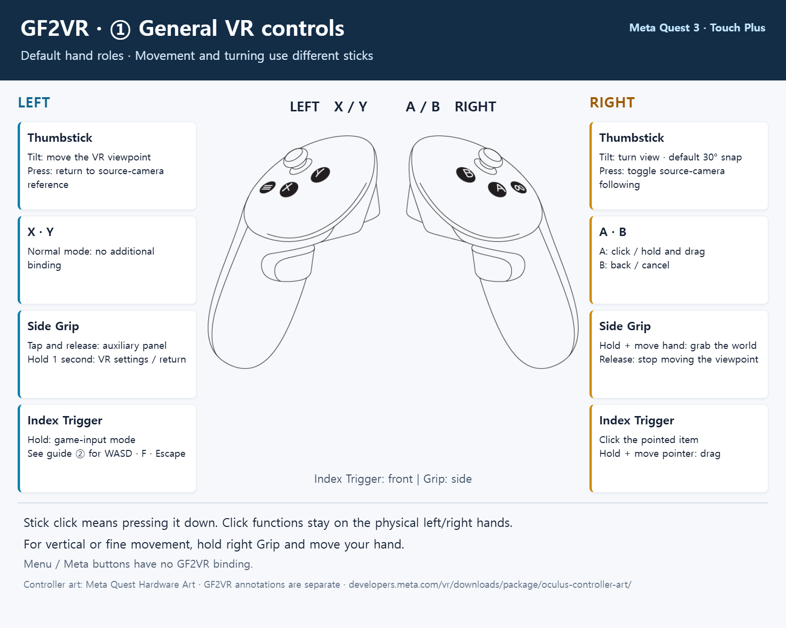
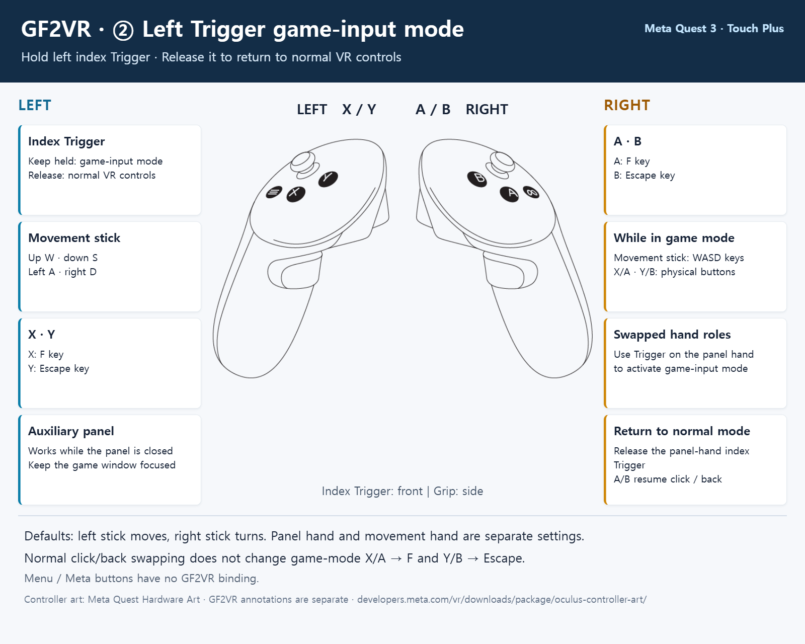

## [English](README.md) | [한국어](README.ko.md) | [日本語](README.ja.md) | [简体中文](README.zh-CN.md)

# GF2VR

Creator: [@TBluebox12](https://x.com/TBluebox12)<br>
Arca VR community: [VR community](https://arca.live/b/vrshits)<br>
Support: [buymeacoffee.com/vrshits](https://buymeacoffee.com/vrshits)

An unofficial mod for playing GF2 Exilium with a VR headset and controllers. Menus appear on a virtual screen, while supported 3D scenes use stereoscopic VR.

[Download a release](https://github.com/deadpixel134/GF2Exilium-VR/releases) · [Full installation guide](docs/en/INSTALLATION.md) · [Full controls guide](docs/en/USAGE.md)

## Requirements and supported environments

- A Windows x64 PC with a working **Haoplay or Steam** installation of GF2 Exilium. The game is not included.
- A VR headset and controllers with a working **SteamVR/OpenXR** connection.
- **Turn OFF anti-aliasing in the game's settings before using VR.**

### Choose Clean or Dirty

| Feature | Clean | Dirty |
|---|---|---|
| Stereo VR, head tracking, controller input and settings | Included | Included |
| White markers for both hands and auxiliary-panel placement | Included | Included |
| Supported character contact, deformation, vibration and jiggle settings | Not included | Included |

Install **one variant at a time**. Clean excludes contact-deformation code; it is not simply Dirty with contact disabled. Both run inside the game process, so the Clean name does not guarantee undetectability or safety. Both support 3DMigoto's default wrapper mode; see [compatibility](docs/en/3DMIGOTO_COMPATIBILITY.md).

## 1. Install

1. Download **one full Clean or Dirty ZIP** under Assets on [Releases](https://github.com/deadpixel134/GF2Exilium-VR/releases). GitHub's `Source code` ZIP is not an installation package.
2. Fully close the game and any existing configurator/installer.
3. Extract the entire ZIP to a **fresh folder outside the game directory**. Keep its files together.
4. Run `GF2VR.Installer.exe` from that folder.
5. Select `GF2_Exilium.exe` or the game folder, review the installation plan and select **Install**. Select the game executable, rather than the launcher, if the location is unclear.
6. Select **Open settings** to review options. You can start with the defaults.

The package includes the OpenXR loader and the .NET runtime needed by the desktop tools. The installer verifies the package and backs up replaced owned files. It places `version.dll` beside the game executable and support files under `vrmod`; original `GameAssembly.dll`, `UnityPlayer.dll` and game assets are not replaced.

### Already installed? Update

**Automatic check and guided update:** Open the installed configurator with the game closed. A normal managed installation of **1.1.6 or later** checks public releases at startup. When a new version appears, select **Update**, approve it and follow the prompts to download, verify and install. GitHub CLI and sign-in are not required. Updates require your consent; a failed check leaves the installation intact.

**Manual update:** Download the full ZIP for your variant, extract it to a fresh folder, close existing tools and run the new `GF2VR.Installer.exe` against the **same game location**. Use this route if no notification appears, the update fails or an old client cannot check releases. To switch Clean↔Dirty, use the desired variant's full ZIP and installer.

Compatible user settings are preserved. If files were modified, use **Repair install** in the latest installer and review its file-by-file plan; keep installation records and backups. See [updating and recovery](docs/en/UPDATE.md).

## 2. Launch in VR

1. Connect the headset and controllers to the PC. If using Virtual Desktop, connect to the PC first.
2. Prepare SteamVR/OpenXR and confirm the headset is ready.
3. Start the game normally through the **Haoplay launcher or Steam**, according to your edition. The installer does not launch it.
4. Keep the game window selected in the Windows foreground for controller input.

## 3. Learn the display and basic controls

Menus and 2D screens appear automatically on a **front panel**. Supported 3D scenes use **stereo VR** with head tracking. To operate the original game UI in 3D, tap **left Grip**, bring the auxiliary hand panel into view, then point and click with the right controller. Grip does not hide the automatic 2D front panel.

### General VR controls



The guides use official Meta Quest 3 Touch Plus artwork. Labels describe GF2VR defaults; see [art credits and button locations](docs/en/CONTROLLER_ART.md).

| Action | Default input |
|---|---|
| Aim at the game panel | Point with the right controller |
| Click / hold and drag | A button or right index Trigger |
| Back / cancel | B button (`Escape`) |
| Move the VR viewpoint | Left stick |
| Turn the view | Right stick — 30° snap by default |
| World grip / fine positioning | Hold right side Grip and move your hand |
| Return to the current original-camera reference | Click the physical left stick |
| Toggle original-camera movement following | Click the physical right stick |
| Show / hide the 3D auxiliary panel | Tap and release left side Grip |
| Open VR settings / return to the game panel | Hold left side Grip for 1 second |

Stick movement follows your view direction: looking up or down while moving forward also moves you vertically. **Use right Grip world grip for vertical movement and fine positioning.** Move your hand as if grabbing the world, then release Grip to keep the new viewpoint. World grip starts ON for new/reset settings; existing saved ON/OFF values are retained.

Return the turning stick to center before the next snap. If Trigger pulls disturb your aim, use **A** to click. A stick click means pressing it down, and its left/right function stays on the physical hand even after changing movement-hand settings. After returning the viewpoint, release and press Grip again before another world grip.

### Game-input mode: WASD, F and Escape



**Hold left index Trigger** to control the game instead of moving the VR viewpoint. This mode also works with the auxiliary panel closed.

| Action | Input while holding left Trigger |
|---|---|
| Game movement | Movement stick: up W, down S, left A, right D |
| F key | X or A |
| Escape key | Y or B |
| Return to normal VR controls | Release left Trigger |

X/Y have no additional normal-mode binding with default hand roles. Swapping panel/pointer hands moves normal click/back to X/Y and the game-mode Trigger to the panel hand. The normal click/back swap does not change game mode's physical X/A → F and Y/B → Escape. Distinguish index **Trigger** from side **Grip**.

### Character contact — Dirty

Bring a hand near supported chest, butt, face or thigh regions. Face and thigh surfaces indent around contact and recover on release; default maximum depths are **8 mm for face / 6 mm for thighs**. Support depends on the character and outfit; unsupported meshes skip indentation.

Contact visualization can be toggled in PC/VR settings and defaults OFF: cyan means idle, orange means active contact. Custom contact targets and saved settings are retained. See [full controls and contact limits](docs/en/USAGE.md).

## 4. Change settings

Open settings from the installer, or run:

```text
<installation root>\vrmod\bin\GF2VR.Configurator\GF2VR.Configurator.exe
```

For the usual Haoplay `GF2 Game/GF2_Exilium.exe` layout, the installation root is the **parent of `GF2 Game`**. For Steam or another direct-executable layout, it is the **folder containing `GF2_Exilium.exe`**.

The PC configurator and VR panel support **Korean, English, Japanese and Simplified Chinese**. Hold left Grip for 1 second to open VR settings. Edit values and select **Save** on PC or **Apply** in VR; supported changes apply to the running game. Settings saved with the game closed take effect at the next launch.

| What to adjust | Settings |
|---|---|
| Image quality / performance | VR render scale |
| Character size / stereo depth | World scale, linked eye separation and movement speed |
| Panel placement | Panel/pointer hand, position, size, rotation and tilt |
| Controls | Movement hand/speed, snap/smooth turn, buttons and world grip |
| Hands / contact | Hand markers; Dirty contact visualization, vibration and regional feedback |

**After changing render scale, allow about 5–10 seconds for VR stereo to return.** A flat view may appear briefly. Wait for the application result. While VR settings are open, game input and artificial movement are blocked; head/hand tracking remains available.

The movement hand defaults to left; changing it swaps movement/turning stick roles together. Visual effects use game defaults; individual VFX toggles are not provided. See [all settings](docs/en/SETTINGS.md), including profiles, defaults and conflicting PC/VR edits.

## Uninstall and roll back

Close the game and configurator, run `GF2VR.Installer.exe` from the full release folder, select the **same game location** and review **Remove**. When a previous installation is recorded, removal restores it; for a first installation it removes owned mod files.

User settings and modified/unowned files are preserved. Keep installation records and backups, and use interrupted-operation recovery if offered. See [removal and previous-install restore](docs/en/INSTALLATION.md).

## Troubleshooting

| Symptom | Check first |
|---|---|
| VR is missing / eyes are misaligned | Turn game anti-aliasing OFF; check headset connection and SteamVR/OpenXR, then relaunch |
| Display works but clicks or game keys do not | Select the game window on the PC; release left Trigger to leave game-input mode |
| Auxiliary panel is missing in 3D | Tap the configured panel hand's Grip and bring the hand into view |
| World grip does not work | Check its saved enable state, activation button and tracked hand; release and press Grip again |
| Stereo pauses after a render-scale change | Wait about 5–10 seconds and read the application result |
| Settings or contact do not take effect | Save/Apply; contact needs Dirty and a supported model; check error text and [settings](docs/en/SETTINGS.md) |
| Update or installation fails | Close the game/tools, use a complete new ZIP and review ownership/Repair messages |

See [troubleshooting](docs/en/TROUBLESHOOTING.md). For reports, include edition, variant/version, headset/connection, affected scene, reproduction steps and error text. Automatic logging defaults OFF; use [log instructions](docs/en/LOGS.md) when needed and remove account/authentication data before sharing.

## Further documentation and development

- [Installation](docs/en/INSTALLATION.md) · [Updating](docs/en/UPDATE.md) · [Controls](docs/en/USAGE.md) · [Settings](docs/en/SETTINGS.md)
- [Compatibility and verification](docs/en/VERIFICATION.md) · [3DMigoto](docs/en/3DMIGOTO_COMPATIBILITY.md)
- [Download contents](docs/en/RELEASE_READINESS.md) · [Developer build guide](docs/en/BUILD_VARIANT_METADATA.md)
- [Release notes](docs/en/RELEASE_NOTES.md) · [GitHub Releases](https://github.com/deadpixel134/GF2Exilium-VR/releases)
- [Source contents and terms of use](SOURCE_BOUNDARY.en.md)

Contributor: [rgbtl1248](https://github.com/rgbtl1248) — 3DMigoto compatibility and build-tool improvements ([PR #1](https://github.com/deadpixel134/GF2Exilium-VR/pull/1)).

## License and rights

A distribution license for GF2VR's project source has **not yet been specified**. A public repository alone does not grant permission to redistribute or distribute modified versions. See [source terms](SOURCE_BOUNDARY.en.md).

OpenXR, MinHook and Microsoft .NET retain their own licenses/notices; see the package's third-party notices and [Microsoft .NET notices](DOTNET-NOTICES.txt). Game files, reference-project assets, user settings, logs and rollback data are excluded from the published source.

> GF2VR is an unofficial fan project, unaffiliated with the game's developer or publisher. A legitimate game installation is required. Game trademarks and copyrighted works belong to their respective owners.
