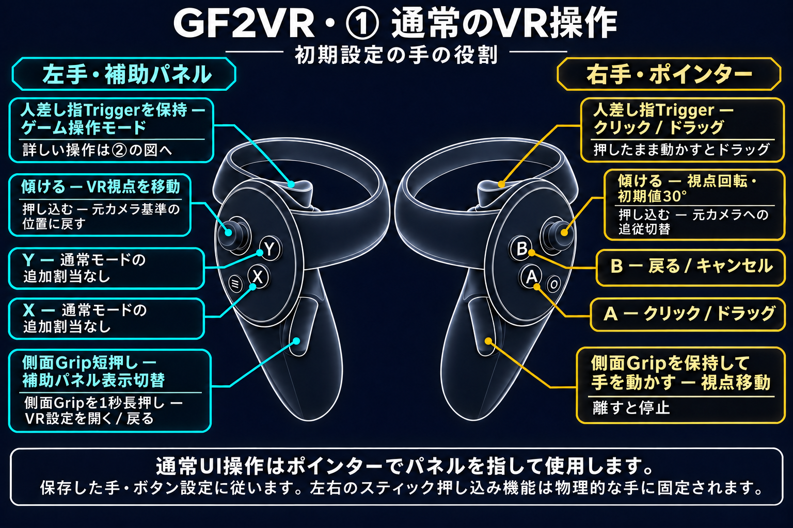
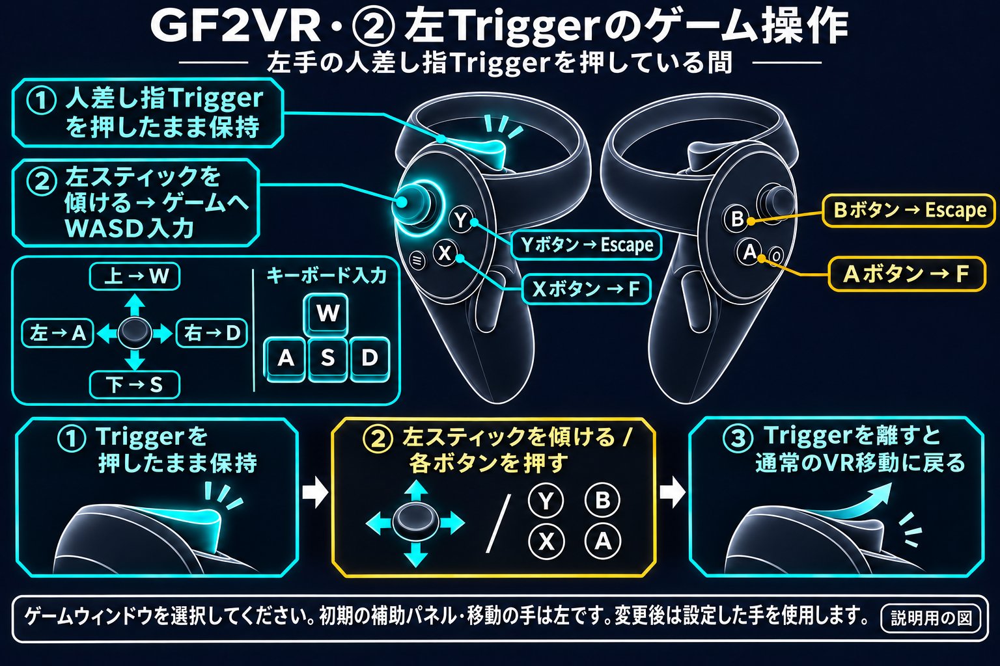

# GF2VR

制作者: [@TBluebox12](https://x.com/TBluebox12)  
Arca Live VR チャンネル: [VR チャンネル](https://arca.live/b/vrshits)  
支援: [buymeacoffee.com/vrshits](https://buymeacoffee.com/vrshits)  

[한국어](README.md) | [English](README.en.md) | [日本語](README.ja.md) | [简体中文](README.zh-CN.md)

GF2 Exilium を VR ヘッドセットとコントローラーで楽しむための非公式 MOD です。通常のメニューは仮想スクリーン、対応する 3D シーンは立体 VR で表示します。

HaoplayとSteamに対応しています。既存のVR・ゲーム内設定機能は実機検証済みです。顔・太ももの押し込みとお尻の外側接触はHaoplayで正常確認済みで、追加機能のSteam HMD検証は未完了です。

**[最新リリースをダウンロード](https://github.com/deadpixel134/GF2Exilium-VR/releases/latest)**

> **必須: VR を使用する前に、ゲーム設定のアンチエイリアスをオフにしてください。**

## VR操作ガイド

### ① 通常のVR操作

### ② 左Triggerのゲーム操作

左手の人差し指Triggerを押している間、初期設定の移動スティックはゲームへWASD入力を送信します。上W・下S・左A・右D、X/AはF、Y/BはEscapeです。Triggerを離すと通常のVR移動に戻ります。

初期設定の手の役割を示す説明用の図です。人差し指のTriggerと側面Gripを区別してください。押し込みはスティックを下に押す操作です。左右の押し込み機能は物理的な手に固定されます。

**右手の側面Gripを保持して手を動かすと、ワールドをつかんで視点を移動できます。Gripを離すと停止します。**

### X・Y・A・Bボタン

初期設定の手の役割・ボタン割当です。ゲーム操作モードは**左手の人差し指Triggerを押している間**に動作します。補助パネル側の手を変更した場合は、その手のTriggerを使用します。

| ボタン | 通常UI操作 | ゲーム操作モード |
|---|---|---|
| X | 追加割当なし | Fキー |
| Y | 追加割当なし | Escapeキー |
| A | クリック・ドラッグ | Fキー |
| B | 戻る・キャンセル | Escapeキー |

パネル・ポインターの手を交換すると、通常UIはXがクリック、Yが戻るになります。クリック・戻るのボタン交換設定は通常UI操作に適用されます。ゲーム操作モードの物理ボタンX/A → F、Y/B → Escapeは固定です。

[操作方法の詳細](docs/ja/USAGE.md)

## できること

頭の動きで見回し、スティックで移動・回転、ポインターでクリックやドラッグができます。元のゲーム画面を手元の補助パネルで開けます。画質・ワールドの大きさ・立体感・操作を設定でき、Dirty には対応キャラクターの胸・臀部への接触、振動・揺れの設定が加わります。

## 貢献者

- [rgbtl1248](https://github.com/rgbtl1248) — 3DMigoto 互換性とビルドツールの改善 ([PR #1](https://github.com/deadpixel134/GF2Exilium-VR/pull/1))。

## 3DMigoto との互換性

Clean・Dirtyの両方が3DMigotoの既定wrapperモードに対応します（[PR #1](https://github.com/deadpixel134/GF2Exilium-VR/pull/1)）。ゲームのwrapperを保持し、VRコピーとOpenXRには実際のD3D11デバイス/contextを使用します。DLLと一致する設定アプリ・インストーラーを同梱します。

[3DMigoto](docs/ja/3DMIGOTO_COMPATIBILITY.md)

## 始める前の準備

- 正常に起動する **Haoplay 版または Steam 版のゲーム**。ゲーム本体は含みません。
- VR ヘッドセットとコントローラー、および接続済みの **SteamVR/OpenXR 環境**。
- ゲーム内の **アンチエイリアスを OFF**。Quest 3・Galaxy XR で報告された左右の映像ずれの原因として確認されています。

## Clean と Dirty の違い

| 機能 | Clean | Dirty |
|---|---|---|
| 通常の VR・立体表示・コントローラー入力・設定 | 含む | 含む |
| 両手の位置を示す白い球 | 含む | 含む |
| キャラクターの胸・臀部への接触と変形 | 含まない | 含む |
| 補助パネルの手動位置・回転・傾き設定 | 含む | 含む |
| 接触振動・揺れと部位別設定 | 含まない | 含む |

接触は、その部位の対応ボーンが接続されたキャラクターで動作します。対応部位はキャラクターモデルによって異なり、宿舎・活動層での実際の臀部の反応はまだ確認されていません。

通常の VR のソース・バージョン・更新は両方で共通です。接触変形コードは Dirty のみで、Clean は単に機能をオフにしたものではなく実装を除外しています。

同時にインストールするのは一方だけです。どちらもゲーム実行ファイルの隣に同じ version.dll 一つを配置し、OpenXR ローダーや設定アプリなどの共通ファイルは vrmod 配下に配置します。元の GameAssembly.dll・UnityPlayer.dll・ゲームアセットは交換しません。両方ともゲームプロセス内で動くため、Clean という名称は非検知や安全を保証しません。

## 初めてのインストール

1. [最新リリース](https://github.com/deadpixel134/GF2Exilium-VR/releases/latest)から **Clean または Dirty の ZIP を一つ**選び、新しいフォルダーにすべて展開します。`Source code` ZIP はインストール用ではありません。
2. ゲームと既存の設定・インストーラーを終了します。展開した `GF2VR.Installer.exe` で `GF2_Exilium.exe` またはゲームフォルダーを選んでインストールします。
3. **設定を開く**からオプションを保存します。SteamVR とヘッドセットを準備し、普段の方法でゲームを起動します。

[インストール・削除・復元](docs/ja/INSTALLATION.md) · [更新・種類の切り替え](docs/ja/UPDATE.md)

## 更新・修復・保存

Settingsの新バージョン案内に同意すると更新できます。自動適用できない場合もバージョンと手動手順を表示し、リリースページは「開く」を押したときだけ開きます。バージョンごとに通知を非表示にできます。

有効なインストール記録がある欠落・隔離ファイルは再インストールできます。変更ファイルは最新ZIPのInstallerで**修復インストール**を選び、ファイルごとの計画に同意すると、元のファイルをバックアップして置換します。所有元不明のファイルは初期状態で除外され、記録・設定・ログ・既存バックアップは保持します。未完了の後処理だけ再試行できます。

設定画面は保存成功・失敗・未保存状態とタイトルの*****を表示します。保存失敗時も編集内容を保持し、未保存で閉じる場合は確認します。ゲームを終了して保存し、適用するには再起動してください。

## 基本操作

| 操作 | 動作 |
|---|---|
| 左スティック | VR 視点の移動 |
| 右スティック | 視野の回転。既定では一度に 30° ずつ回るスナップ方式 |
| 右手のポインター | ゲーム画面の項目を指します。 |
| 右手の Trigger または A | 指している項目をクリック |
| 右手の B | 戻る・キャンセル |
| 左手の Grip | 3D 画面で補助パネルを開閉 |

[起動とすべての操作](docs/ja/USAGE.md) · [設定項目](docs/ja/SETTINGS.md)

## 互換性と確認範囲

実機確認はDirtyのHaoplay Main・Activityでの手表示と接触、およびSteam Mainでの起動と立体表示です。Steamの他の画面と新しいClean DLLのHMD動作は別途未確認です。

従来の実機確認環境: Meta Quest 2 · 4K モニター · Virtual Desktop。

Quest 3 と Galaxy XR で報告された左右映像のずれは、アンチエイリアスが原因であると確認されました。VR を使用する前に、ゲーム設定のアンチエイリアスをオフにしてください。

## 詳しいガイド

- [インストール・削除・復元](docs/ja/INSTALLATION.md)
- [起動とすべての操作](docs/ja/USAGE.md)
- [設定項目](docs/ja/SETTINGS.md)
- [更新](docs/ja/UPDATE.md)
- [トラブルシューティング](docs/ja/TROUBLESHOOTING.md)
- [ログの保存と送付](docs/ja/LOGS.md)
- [ダウンロードとファイル構成](docs/ja/RELEASE_READINESS.md)
- [検証範囲](docs/ja/VERIFICATION.md)
- [3DMigoto 互換性](docs/ja/3DMIGOTO_COMPATIBILITY.md)
- [開発者向けビルド](docs/ja/BUILD_VARIANT_METADATA.md)
- [変更履歴](docs/ja/RELEASE_NOTES.md) · [GitHub Releases](https://github.com/deadpixel134/GF2Exilium-VR/releases)
- [ソース構成と利用条件](SOURCE_BOUNDARY.ja.md)

> GF2VR は非公式ファンプロジェクトです。正規にインストールしたゲームが必要です。ゲームの商標・著作物の権利は各権利者に帰属します。

## キャラクター接触（Dirty）

Dirty版では、対応するキャラクターの胸・お尻・顔・左右の太ももに手を近づけると接触を判定します。顔と太ももは接触周辺がへこみ、手を離すと復元されます。標準の最大量は顔8mm、太もも6mmです。接触位置表示はPCまたはVR設定で切り替えられ、初期値はOFFです。水色は非接触、オレンジ色は接触中です。既存のカスタム接触対象と保存設定は維持されます。
