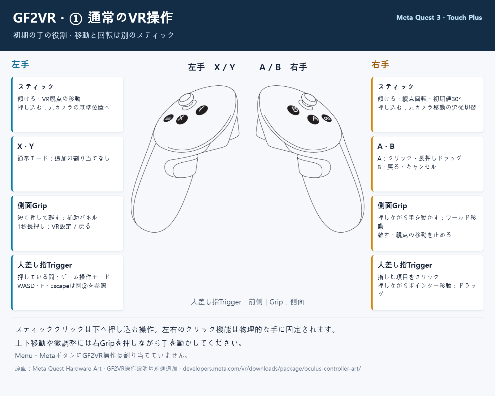
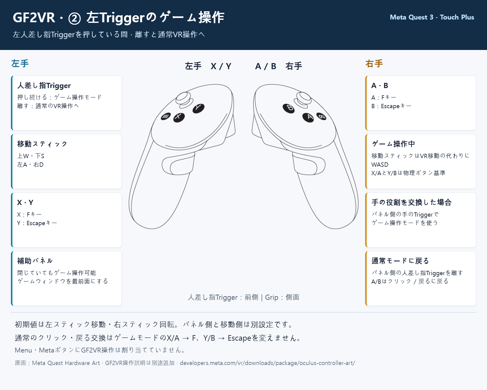

## [English](README.md) | [한국어](README.ko.md) | [日本語](README.ja.md) | [简体中文](README.zh-CN.md)

# GF2VR

制作者: [@TBluebox12](https://x.com/TBluebox12)<br>
Arca Live VR チャンネル: [VR チャンネル](https://arca.live/b/vrshits)<br>
支援: [buymeacoffee.com/vrshits](https://buymeacoffee.com/vrshits)

GF2 Exilium を VR ヘッドセットとコントローラーで楽しむための非公式 MOD です。通常のメニューは仮想スクリーン、対応する 3D シーンは立体 VR で表示します。

[リリースをダウンロード](https://github.com/deadpixel134/GF2Exilium-VR/releases) · [詳しいインストール手順](docs/ja/INSTALLATION.md) · [詳しい操作方法](docs/ja/USAGE.md)

## 必要なものと対応環境

- 正常に起動できるGF2 Exiliumの**Haoplay版またはSteam版**とWindows x64 PC。ゲーム本体は含まれません。
- VRヘッドセット・コントローラーと、正常に接続された**SteamVR/OpenXR**環境。
- **VRを使う前にゲーム設定のアンチエイリアスをオフにしてください。**

### CleanとDirtyを選ぶ

| 機能 | Clean | Dirty |
|---|---|---|
| 立体VR・頭の追跡・コントローラー入力・設定 | あり | あり |
| 両手の白い球表示と補助パネル配置設定 | あり | あり |
| 対応キャラクターの接触・変形・振動・揺れ設定 | なし | あり |

**どちらか一方だけをインストールしてください。** Cleanは接触変形コードを含まないビルドで、Dirtyの接触を無効化しただけのものではありません。どちらもゲームプロセス内で動くため、Cleanという名前は未検出や安全性を保証しません。両ビルドは3DMigotoの標準wrapperモードに対応します。[互換性の案内](docs/ja/3DMIGOTO_COMPATIBILITY.md)を参照してください。

## 1. インストールする

1. [Releases](https://github.com/deadpixel134/GF2Exilium-VR/releases)のAssetsから、**CleanまたはDirtyの完全なZIPを1つ**ダウンロードします。GitHubの`Source code` ZIPはインストール用ではありません。
2. ゲームと既存の設定プログラム・インストーラーを完全に終了します。
3. ZIP全体を**ゲームフォルダー外の新しいフォルダー**に展開します。同梱ファイルは分離しないでください。
4. 展開したフォルダーの`GF2VR.Installer.exe`を実行します。
5. `GF2_Exilium.exe`またはゲームフォルダーを選び、インストール計画を確認して**インストール**を押します。場所が不明な場合はランチャーではなくゲーム実行ファイルを選んでください。
6. **設定を開く**でオプションを確認します。最初は初期値で始められます。

OpenXRローダーとデスクトップツールに必要な.NETランタイムは同梱されています。インストーラーはパッケージを検証し、置き換える既存の所有ファイルをバックアップします。ゲーム実行ファイルの隣に`version.dll`、`vrmod`配下に補助ファイルを配置し、元の`GameAssembly.dll`・`UnityPlayer.dll`・ゲームアセットは置き換えません。

### インストール済みの場合：更新する

**自動確認と案内に従う更新：** ゲームを終了して、インストール済みの設定プログラムを開きます。正常なインストール記録がある**1.1.6以降**では、起動時に公開リリースを自動確認します。新しいバージョンが表示されたら**更新**を選び、同意してダウンロード・検証・インストールを進めます。GitHub CLIやログインは不要です。インストールには同意が必要で、確認に失敗しただけでは既存の環境は変わりません。

**手動更新：** 使用中のビルドの完全なZIPを新しいフォルダーに展開し、既存ツールを終了して、新しい`GF2VR.Installer.exe`で**以前と同じゲームの場所**を指定してインストールします。通知がない、更新に失敗する、古いクライアントでリリースを確認できない場合はこの方法を使ってください。Clean↔Dirtyの切り替えも、希望するビルドの完全なZIPとインストーラーを使います。

互換性のあるユーザー設定は保持します。ファイルが変更されている場合は、最新インストーラーの**修復インストール**でファイルごとの計画を確認してください。インストール記録とバックアップは保管します。[更新・復旧の案内](docs/ja/UPDATE.md)を参照してください。

## 2. VRで起動する

1. ヘッドセットとコントローラーをPCに接続します。Virtual Desktopを使う場合は、先にPCへ接続してください。
2. SteamVR/OpenXR環境を準備し、ヘッドセットが使用可能な状態であることを確認します。
3. ゲームの版に応じて、**HaoplayランチャーまたはSteam**から通常の方法で起動します。インストーラーはゲームを起動しません。
4. コントローラー入力を使うには、PCでゲームウィンドウを選択してWindowsの最前面に置きます。

## 3. 表示方式と基本操作

メニュー・2D画面は**正面パネル**に自動表示します。対応する3Dシーンは頭の動きを反映する**立体VR**です。3Dで元のゲームUIを操作するには、**左Gripを短く押して離し**、手の補助パネルを視野内に入れて右手で指してクリックします。Gripで自動表示の2D正面パネルを隠すことはできません。

### 通常のVR操作



Meta Quest 3 Touch Plusの公式原画を使用しています。操作説明はGF2VRの初期設定です。[画像の出典とボタン位置](docs/ja/CONTROLLER_ART.md)を参照してください。

| 操作 | 初期入力 |
|---|---|
| ゲームパネルを狙う | 右コントローラーで指す |
| クリック・長押しドラッグ | Aボタンまたは右人差し指Trigger |
| 戻る・キャンセル | Bボタン（`Escape`） |
| VR視点の移動 | 左スティック |
| 視点回転 | 右スティック — 初期値30°スナップ |
| ワールドグリップ・位置の微調整 | 右側面Gripを押しながら手を動かす |
| 現在の元カメラ基準位置に戻る | 物理的な左スティックを押し込む |
| 元カメラの移動追従を切り替える | 物理的な右スティックを押し込む |
| 3D補助パネルの表示・非表示 | 左側面Gripを短く押して離す |
| VR設定を開く・ゲームパネルに戻る | 左側面Gripを1秒長押し |

スティック移動は見ている方向に従い、上や下を見ながら前進すると高さも変わります。**上下移動や位置の微調整には右Gripのワールドグリップを使ってください。** 世界をつかんで動かすように手を動かし、Gripを離すと視点がその位置に残ります。新規設定・初期値復元時はONで、既存の保存済みON/OFF値は保持します。

次のスナップ回転の前にスティックを中央へ戻してください。Triggerを引くと照準がずれる場合は**Aボタン**でクリックします。スティックのクリックは下へ押し込む操作です。移動側を変えても左右のクリック機能は物理的な手に固定されます。視点を戻した後は、Gripを離してから押し直すと再びワールドグリップを使えます。

### ゲーム操作モード：WASD・F・Escape



**左人差し指Triggerを押している間**は、VR視点移動の代わりにゲームを操作します。補助パネルが閉じていても使えます。

| 操作 | 左Triggerを押している間の入力 |
|---|---|
| ゲーム内移動 | 移動スティック：上W・下S・左A・右D |
| Fキー | XまたはA |
| Escapeキー | YまたはB |
| 通常のVR操作に戻る | 左Triggerを離す |

初期の手の役割では、X/Yに通常モードの追加割り当てはありません。パネル・ポインターの手を交換すると、通常のクリック・戻るはX/Yへ、ゲームモードのTriggerはパネル側の手へ移ります。通常のクリック・戻る交換設定は、ゲームモードの物理ボタンX/A → F、Y/B → Escapeを変更しません。人差し指の**Trigger**と側面の**Grip**を区別してください。

### キャラクター接触 — Dirty

対応する胸・お尻・顔・太ももへ手を近づけると接触を判定します。顔と太ももは接触周辺がへこみ、離すと復元します。最大深さの初期値は**顔8mm・太もも6mm**です。対応範囲はキャラクター・衣装に依存し、処理できないメッシュの押し込みはスキップします。

接触位置表示はPC・VR設定で切り替えられ、初期値はOFFです。シアンは非接触、オレンジは接触中です。独自の接触対象と保存済み設定は保持します。[詳しい操作と接触の制限](docs/ja/USAGE.md)を参照してください。

## 4. 設定を変える

インストーラーの**設定を開く**、または以下のプログラムを使います。

```text
<インストールルート>\vrmod\bin\GF2VR.Configurator\GF2VR.Configurator.exe
```

通常のHaoplayの`GF2 Game/GF2_Exilium.exe`構成では、**`GF2 Game`の親フォルダー**がインストールルートです。Steamなど実行ファイルが直接置かれる構成では、**`GF2_Exilium.exe`があるフォルダー**です。

PC設定画面とVRパネルは**韓国語・英語・日本語・簡体字中国語**に対応します。左Gripを1秒長押しするとVR設定が開きます。値を編集し、PCでは**保存**、VRでは**適用**を選ぶと、対応する変更が実行中のゲームに反映されます。ゲーム終了中に保存した設定は次の起動で使われます。

| 調整したい項目 | 設定内容 |
|---|---|
| 画質・性能 | VRレンダー解像度倍率 |
| キャラクターの大きさ・立体感 | ワールドスケール、目の間隔・移動速度の連動 |
| パネル配置 | パネル・ポインターの手、位置・大きさ・回転・傾き |
| 操作方法 | 移動側と速度、スナップ・スムーズ回転、ボタンとワールドグリップ |
| 手・接触 | 手表示、Dirtyの接触位置表示・振動・部位別反応 |

**レンダー倍率変更後、立体VRの復帰まで約5～10秒お待ちください。** 一時的に平面表示になることがあります。適用結果を確認してください。VR設定の表示中はゲーム入力と人工的な移動が止まり、頭と手の追跡は維持されます。

移動側の初期値は左手で、変更すると移動・回転スティックの役割が一緒に入れ替わります。画面効果はゲーム初期値を使い、個別VFX切り替えは提供しません。プロファイル・初期値復元・PC/VR同時編集については[全設定の案内](docs/ja/SETTINGS.md)を参照してください。

## アンインストールとロールバック

ゲームと設定プログラムを終了し、完全な配布フォルダーの`GF2VR.Installer.exe`で**同じゲームの場所**を選んで**削除**の計画を確認します。以前のインストール記録があればそれを復元し、初回インストールならMod所有ファイルを削除します。

ユーザー設定と、変更済み・所有が確認できないファイルは保持します。インストール記録とバックアップを保管し、中断した操作の復旧が提示されたら案内に従ってください。[削除・以前のインストールの復元](docs/ja/INSTALLATION.md)を参照してください。

## 症状別のトラブル対処

| 症状 | 最初に確認すること |
|---|---|
| VRが出ない・左右の映像がずれる | ゲームのアンチエイリアスをOFF、接続とSteamVR/OpenXRを確認して再起動 |
| 表示されるがクリック・ゲームキーが効かない | PCでゲームウィンドウを選び、左Triggerを離してゲームモードを解除 |
| 3D補助パネルが見えない | 設定したパネル側Gripを短く押し、手を視野に入れる |
| ワールドグリップが動かない | 保存済みの有効状態・ボタン・追跡する手を確認し、Gripを押し直す |
| レンダー倍率変更後に立体表示が止まる | 約5～10秒待って適用結果を確認 |
| 設定・接触が反映されない | 保存・適用を確認。接触にはDirtyと対応モデルが必要。エラーと[設定案内](docs/ja/SETTINGS.md)を確認 |
| 更新・インストールに失敗 | ゲームとツールを終了し、新しい完全ZIPと所有・修復の案内を確認 |

[トラブル対処](docs/ja/TROUBLESHOOTING.md)を参照してください。報告にはゲーム版・ビルド/バージョン・ヘッドセット/接続・発生シーン・再現手順・エラー文を含めてください。自動ログの初期値はOFFです。必要なら[ログの案内](docs/ja/LOGS.md)に従い、共有前にアカウント・認証情報を除いてください。

## 詳細ドキュメントと開発情報

- [インストール](docs/ja/INSTALLATION.md) · [更新](docs/ja/UPDATE.md) · [操作](docs/ja/USAGE.md) · [設定](docs/ja/SETTINGS.md)
- [互換性と検証範囲](docs/ja/VERIFICATION.md) · [3DMigoto](docs/ja/3DMIGOTO_COMPATIBILITY.md)
- [ダウンロード内容](docs/ja/RELEASE_READINESS.md) · [開発者ビルドガイド](docs/ja/BUILD_VARIANT_METADATA.md)
- [変更履歴](docs/ja/RELEASE_NOTES.md) · [GitHub Releases](https://github.com/deadpixel134/GF2Exilium-VR/releases)
- [ソース構成と利用条件](SOURCE_BOUNDARY.ja.md)

貢献者：[rgbtl1248](https://github.com/rgbtl1248) — 3DMigoto互換性とビルドツールの改善（[PR #1](https://github.com/deadpixel134/GF2Exilium-VR/pull/1)）。

## ライセンスと権利について

GF2VRプロジェクトソースの配布ライセンスは**まだ指定されていません**。公開リポジトリであるだけでは、再配布や改変版の配布が許可されるわけではありません。[ソースの利用条件](SOURCE_BOUNDARY.ja.md)を参照してください。

OpenXR・MinHook・Microsoft .NETにはそれぞれのライセンス・告知が適用されます。同梱の外部コンポーネント告知と[Microsoft .NET告知](DOTNET-NOTICES.txt)を参照してください。公開ソースにゲームファイル・参照プロジェクトのアセット・ユーザー設定・ログ・ロールバックデータは含みません。

> GF2VRはゲーム開発元・配信元とは関係のない非公式ファンプロジェクトです。正規にインストールしたゲームが必要です。ゲームの商標・著作物の権利は各権利者に帰属します。
