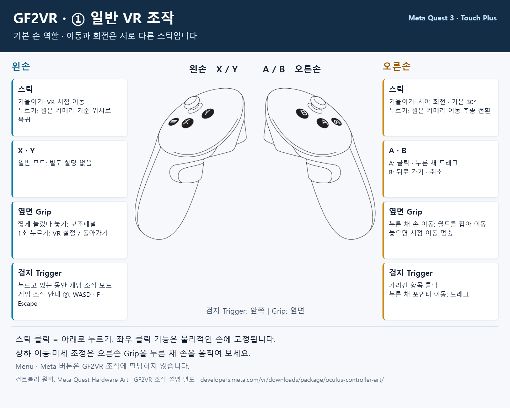
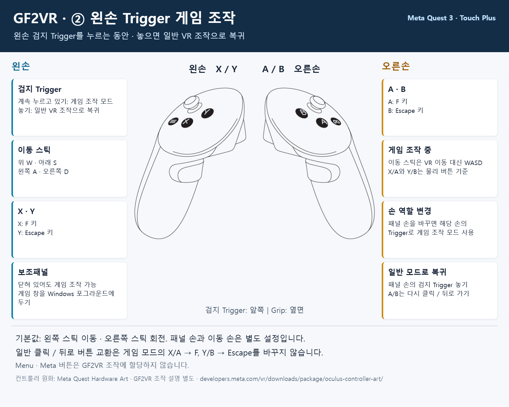

## [English](README.md) | [한국어](README.ko.md) | [日本語](README.ja.md) | [简体中文](README.zh-CN.md)

# GF2VR

제작자: [@TBluebox12](https://x.com/TBluebox12)<br>
아카라이브 가상현실 채널: [가상현실 채널](https://arca.live/b/vrshits)<br>
후원: [buymeacoffee.com/vrshits](https://buymeacoffee.com/vrshits)

소녀전선 2: 망명(GF2 Exilium)을 VR 헤드셋과 컨트롤러로 즐기기 위한 비공식 모드입니다. 일반 메뉴는 가상 화면으로, 지원되는 3D 장면은 입체 화면으로 표시합니다.

[릴리스 다운로드](https://github.com/deadpixel134/GF2Exilium-VR/releases) · [자세한 설치 안내](docs/ko/INSTALLATION.md) · [자세한 조작 안내](docs/ko/USAGE.md)

## 준비물과 지원 환경

- 정상 실행되는 **Haoplay 또는 Steam판** 소녀전선 2와 Windows x64 PC. 게임 본편은 포함하지 않습니다.
- VR 헤드셋·컨트롤러와 정상 연결된 **SteamVR/OpenXR** 환경.
- **VR 사용 전 게임 설정에서 안티앨리어싱을 끄세요.**

### Clean과 Dirty 선택

| 기능 | Clean | Dirty |
|---|---|---|
| 입체 VR·머리 추적·컨트롤러 입력·설정 | 포함 | 포함 |
| 흰색 양손 구 표시와 보조패널 배치 설정 | 포함 | 포함 |
| 지원 캐릭터 접촉·변형·진동·흔들림 설정 | 미포함 | 포함 |

**둘 중 하나만 설치하세요.** Clean은 접촉 변형 코드를 제외한 빌드로, Dirty에서 접촉만 꺼 둔 버전이 아닙니다. 둘 다 게임 프로세스 안에서 실행되므로 Clean이라는 이름이 미감지·안전을 보장하지 않습니다. 두 빌드 모두 3DMigoto 기본 wrapper 모드를 지원합니다. [호환성 안내](docs/ko/3DMIGOTO_COMPATIBILITY.md)를 참고하세요.

## 1. 설치하기

1. [Releases](https://github.com/deadpixel134/GF2Exilium-VR/releases)의 Assets에서 **Clean 또는 Dirty 전체 ZIP 하나**를 내려받습니다. GitHub의 `Source code` ZIP은 설치 파일이 아닙니다.
2. 게임과 기존 설정 프로그램·설치기를 완전히 종료합니다.
3. ZIP 전체를 **게임 폴더 밖의 새 폴더**에 풉니다. 함께 들어 있는 파일을 분리하지 마세요.
4. 압축을 푼 폴더의 `GF2VR.Installer.exe`를 실행합니다.
5. `GF2_Exilium.exe` 또는 게임 폴더를 선택하고 설치 계획을 확인한 뒤 **설치**를 누릅니다. 위치가 헷갈리면 런처 대신 게임 실행 파일을 선택하세요.
6. **설정 열기**에서 옵션을 확인합니다. 처음에는 기본값으로 시작할 수 있습니다.

OpenXR 로더와 데스크톱 도구에 필요한 .NET 런타임은 패키지에 포함됩니다. 설치기는 패키지를 검증하고 교체할 기존 소유 파일을 백업합니다. 게임 실행 파일 옆에 `version.dll`, `vrmod` 아래에 지원 파일을 설치하며 원본 `GameAssembly.dll`·`UnityPlayer.dll`·게임 에셋은 교체하지 않습니다.

### 이미 설치했다면: 업데이트하기

**자동 확인·안내에 따른 업데이트:** 게임을 종료하고 설치된 설정 프로그램을 엽니다. 정상적인 설치 기록이 있는 **1.1.6 이상**은 설정 창을 열 때 공개 릴리스를 자동 확인합니다. 새 버전이 표시되면 **업데이트**를 누르고 동의한 뒤 다운로드·검증·설치를 진행하세요. GitHub CLI나 로그인은 필요하지 않습니다. 설치는 사용자 동의 후 진행되며, 확인 실패만으로 기존 설치가 바뀌지 않습니다.

**수동 업데이트:** 사용 중인 빌드의 전체 ZIP을 새 폴더에 풀고 기존 도구를 종료한 뒤, 새 `GF2VR.Installer.exe`에서 **기존과 같은 게임 위치**를 선택해 설치합니다. 알림이 없거나 업데이트에 실패했거나 구버전에서 릴리스를 확인하지 못하면 이 방법을 사용하세요. Clean↔Dirty 전환도 원하는 빌드의 전체 ZIP과 설치기를 사용합니다.

호환되는 기존 사용자 설정은 보존합니다. 파일이 수정된 경우 최신 설치기의 **복구 설치**에서 파일별 계획을 확인하세요. 설치 기록과 백업은 보관합니다. [업데이트·복구 안내](docs/ko/UPDATE.md)를 참고하세요.

## 2. VR로 실행하기

1. 헤드셋과 컨트롤러를 PC에 연결합니다. Virtual Desktop을 쓴다면 먼저 PC에 연결하세요.
2. SteamVR/OpenXR 환경을 준비하고 헤드셋 연결 상태를 확인합니다.
3. 게임 판본에 맞게 **Haoplay 런처 또는 Steam**에서 평소 방법으로 게임을 실행합니다. 설치기는 게임을 실행하지 않습니다.
4. 컨트롤러 입력을 사용하려면 PC에서 게임 창을 선택해 Windows 포그라운드에 둡니다.

## 3. 화면 표시 방식과 기본 조작

메뉴·2D 화면은 **정면 패널**에 자동 표시합니다. 지원되는 3D 장면은 머리 움직임을 반영하는 **입체 VR**로 표시합니다. 3D에서 원래 게임 UI를 조작하려면 **왼손 Grip을 짧게 눌렀다 놓고**, 손의 보조패널을 시야 안으로 가져와 오른손으로 가리켜 클릭하세요. Grip으로 자동 표시되는 2D 정면 패널을 숨길 수는 없습니다.

### 일반 VR 조작



이미지는 Meta Quest 3의 Touch Plus 공식 원화를 사용합니다. 조작 설명은 GF2VR 기본 설정이며, [이미지 출처와 버튼 위치](docs/ko/CONTROLLER_ART.md)를 참고하세요.

| 동작 | 기본 입력 |
|---|---|
| 게임 패널의 커서 조준 | 오른손 컨트롤러로 가리키기 |
| 클릭·누른 채 드래그 | A 버튼 또는 오른손 검지 Trigger |
| 뒤로 가기·취소 | B 버튼 (`Escape`) |
| VR 시점 이동 | 왼쪽 스틱 |
| 시야 회전 | 오른쪽 스틱 — 기본 30° 스냅 턴 |
| 월드 그립·위치 미세 조정 | 오른손 옆면 Grip을 누른 채 손 이동 |
| 현재 원본 카메라 기준 위치로 복귀 | 물리적 왼쪽 스틱 클릭 |
| 원본 카메라 이동 추종 전환 | 물리적 오른쪽 스틱 클릭 |
| 3D 보조패널 열기·닫기 | 왼손 옆면 Grip을 짧게 눌렀다 놓기 |
| VR 설정 열기·게임 패널로 돌아가기 | 왼손 옆면 Grip을 1초 누르기 |

스틱 이동은 바라보는 방향을 따르므로 위나 아래를 보면서 전진하면 높이도 바뀝니다. **상하 이동과 위치 미세 조정에는 오른손 Grip의 월드 그립을 사용해 보세요.** 월드를 잡아 옮기듯 손을 움직이고 Grip을 놓으면 그 시점이 유지됩니다. 새 설정·기본값 복원 시 월드 그립은 ON이며, 기존에 저장한 ON/OFF 값은 유지합니다.

다시 스냅 회전하려면 스틱을 중앙으로 돌려놓았다가 기울이세요. Trigger를 당길 때 조준이 흔들리면 **A 버튼**으로 클릭해 보세요. 스틱 클릭은 아래로 누르는 동작이며, 이동 손을 바꿔도 좌우 클릭 기능은 물리적인 손에 고정됩니다. 시점 복귀 후 월드 그립을 다시 쓰려면 Grip을 놓았다가 다시 누르세요.

### 게임 조작 모드: WASD·F·Escape



**왼손 검지 Trigger를 누르는 동안** VR 시점 이동 대신 게임을 조작합니다. 보조패널이 닫혀 있어도 사용할 수 있습니다.

| 동작 | 왼손 Trigger를 누르는 동안의 입력 |
|---|---|
| 게임 내 이동 | 이동 스틱: 위 W·아래 S·왼쪽 A·오른쪽 D |
| F 입력 | X 또는 A |
| Escape 입력 | Y 또는 B |
| 일반 VR 조작으로 복귀 | 왼손 Trigger 놓기 |

기본 손 역할에서 X·Y는 일반 모드의 별도 할당이 없습니다. 패널·포인터 손을 교환하면 일반 클릭·뒤로가기는 X·Y로, 게임 모드 Trigger는 보조패널 손으로 옮겨집니다. 일반 클릭·뒤로가기 교환 설정은 게임 모드의 물리 버튼 X/A → F, Y/B → Escape를 바꾸지 않습니다. 검지 **Trigger**와 옆면 **Grip**을 구분하세요.

### 캐릭터 접촉 — Dirty

지원되는 가슴·엉덩이·얼굴·허벅지에 손을 가까이 대면 접촉을 판정합니다. 얼굴·허벅지는 접촉 주변이 눌리고 손을 떼면 복원되며, 기본 최대 깊이는 **얼굴 8mm·허벅지 6mm**입니다. 지원 여부는 캐릭터·의상에 따라 다르며 처리할 수 없는 메시의 눌림은 건너뜁니다.

접촉 위치 표시는 PC·VR 설정에서 켜고 끌 수 있고 기본값은 OFF입니다. 청록색은 비접촉, 주황색은 접촉 중입니다. 사용자 지정 접촉 대상과 저장한 설정은 유지합니다. [전체 조작법과 접촉 제한](docs/ko/USAGE.md)을 참고하세요.

## 4. 설정 바꾸기

설치기의 **설정 열기**를 누르거나 아래 프로그램을 실행합니다.

```text
<설치 루트>\vrmod\bin\GF2VR.Configurator\GF2VR.Configurator.exe
```

일반적인 Haoplay의 `GF2 Game/GF2_Exilium.exe` 구조에서는 **`GF2 Game`의 상위 폴더**가 설치 루트입니다. Steam 등 게임 실행 파일이 바로 있는 구조에서는 **`GF2_Exilium.exe`가 있는 폴더**가 설치 루트입니다.

PC 설정 창과 VR 패널은 **한국어·영어·일본어·중국어 간체**를 지원합니다. 왼손 Grip을 1초 누르면 VR 설정이 열립니다. 값을 바꾼 뒤 PC에서는 **저장**, VR에서는 **적용**을 누르면 지원되는 변경이 실행 중인 게임에 반영됩니다. 게임을 종료한 상태에서 저장한 설정은 다음 실행에 적용됩니다.

| 바꾸고 싶은 항목 | 설정할 내용 |
|---|---|
| 화질·성능 | VR 렌더 해상도 배율 |
| 캐릭터 크기·입체감 | 월드 크기, 눈 간격·이동 속도 연동 |
| 패널 배치 | 패널·포인터 손, 위치·크기·회전·기울기 |
| 조작 방식 | 이동 손·속도, 스냅·연속 회전, 버튼과 월드 그립 |
| 손·접촉 | 손 표시, Dirty 접촉 위치 표시·진동·부위별 반응 |

**렌더 배율 변경 후 VR 입체 화면 복원까지 약 5~10초 기다려 주세요.** 잠시 평면 화면이 보일 수 있으니 적용 결과를 확인하세요. VR 설정을 연 동안 게임 입력과 인위적인 이동은 차단되며 머리·손 추적은 유지됩니다.

이동 손은 기본 왼손이며, 바꾸면 이동·회전 스틱 역할이 함께 교환됩니다. 화면 효과는 게임 기본값을 사용하며 개별 VFX 토글은 제공하지 않습니다. 프로필·기본값 복원·PC/VR 동시 편집 안내는 [전체 설정](docs/ko/SETTINGS.md)을 참고하세요.

## 제거와 롤백

게임과 설정 프로그램을 종료한 뒤 전체 배포 폴더의 `GF2VR.Installer.exe`에서 **같은 게임 위치**를 선택하고 **제거** 계획을 확인합니다. 이전 설치 기록이 있으면 해당 설치를 복원하고, 최초 설치라면 모드 소유 파일을 제거합니다.

사용자 설정과 수정되거나 소유가 확인되지 않은 파일은 보존합니다. 설치 기록·백업을 보관하고 중단된 작업 복구가 제시되면 안내를 따르세요. [제거·이전 설치 복원](docs/ko/INSTALLATION.md)을 참고하세요.

## 증상별 문제 해결

| 증상 | 먼저 확인할 내용 |
|---|---|
| VR 화면이 없거나 양안 영상이 어긋남 | 게임 안티앨리어싱 OFF, 헤드셋 연결·SteamVR/OpenXR 확인 후 재실행 |
| 화면은 나오지만 클릭·게임 키 입력이 안 됨 | PC에서 게임 창 선택, 왼손 Trigger를 놓아 게임 조작 모드 해제 |
| 3D 보조패널이 안 보임 | 설정된 패널 손의 Grip을 짧게 누르고 손을 시야 안으로 이동 |
| 월드 그립이 안 됨 | 저장된 사용 여부·활성 버튼·추적 손 확인, Grip을 놓았다가 다시 누르기 |
| 렌더 배율 변경 후 입체 화면이 잠시 멈춤 | 약 5~10초 기다린 뒤 적용 결과 확인 |
| 설정·접촉이 반영되지 않음 | 저장·적용 여부 확인, 접촉은 Dirty·지원 모델 필요, 오류와 [설정 안내](docs/ko/SETTINGS.md) 확인 |
| 업데이트·설치 실패 | 게임·도구 종료, 새 전체 ZIP 사용, 소유권·복구 설치 안내 확인 |

[문제 해결](docs/ko/TROUBLESHOOTING.md)을 참고하세요. 제보에는 게임 판본·빌드/버전·헤드셋/연결 방식·발생 장면·재현 순서·오류 문구를 적어 주세요. 자동 로그는 기본 OFF입니다. 필요하면 [로그 안내](docs/ko/LOGS.md)를 따르고 공유 전 계정·인증 정보를 제거하세요.

## 상세 문서와 개발 정보

- [설치](docs/ko/INSTALLATION.md) · [업데이트](docs/ko/UPDATE.md) · [조작법](docs/ko/USAGE.md) · [설정](docs/ko/SETTINGS.md)
- [호환성과 검증 범위](docs/ko/VERIFICATION.md) · [3DMigoto](docs/ko/3DMIGOTO_COMPATIBILITY.md)
- [다운로드 파일 구성](docs/ko/RELEASE_READINESS.md) · [개발자 빌드 안내](docs/ko/BUILD_VARIANT_METADATA.md)
- [변경 기록](docs/ko/RELEASE_NOTES.md) · [GitHub Releases](https://github.com/deadpixel134/GF2Exilium-VR/releases)
- [소스 구성과 이용 조건](SOURCE_BOUNDARY.md)

기여자: [rgbtl1248](https://github.com/rgbtl1248) — 3DMigoto 호환성 및 빌드 도구 개선 ([PR #1](https://github.com/deadpixel134/GF2Exilium-VR/pull/1)).

## 라이선스와 권리 안내

GF2VR 자체 코드는 [GNU General Public License v3.0](LICENSE) (GPL-3.0-only)을 따릅니다. [소스 이용 조건](SOURCE_BOUNDARY.md)을 참고하세요.

OpenXR·MinHook·Microsoft .NET에는 각자의 라이선스·고지가 적용됩니다. 패키지의 외부 구성 요소 고지와 [Microsoft .NET 고지](DOTNET-NOTICES.txt) · [타사 구성 요소와 버전](THIRD_PARTY_NOTICES.md)를 참고하세요. 공개 소스에는 게임 파일·참조 프로젝트 에셋·사용자 설정·로그·롤백 데이터를 포함하지 않습니다.

> GF2VR은 게임 개발사·배급사와 관련 없는 비공식 팬 프로젝트입니다. 정식으로 설치한 게임이 필요하며, 게임의 상표·저작물은 각 권리자에게 있습니다.
