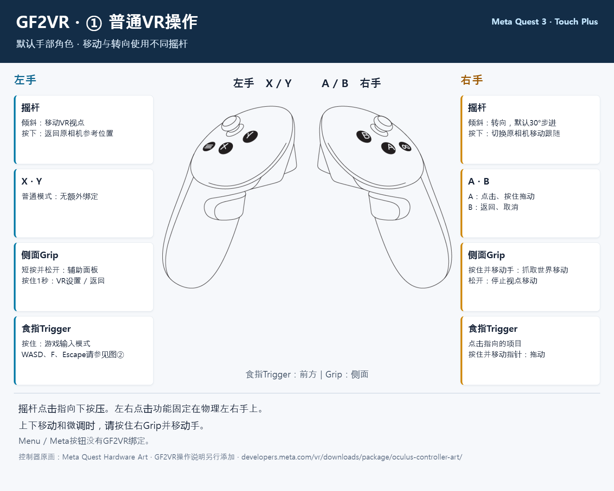
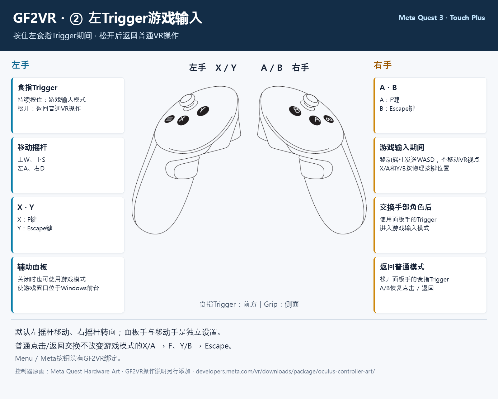

# GF2VR

作者: [@TBluebox12](https://x.com/TBluebox12)<br>
Arca Live VR 社区: [VR 社区](https://arca.live/b/vrshits)<br>
赞助: [buymeacoffee.com/vrshits](https://buymeacoffee.com/vrshits)

[English](README.md) | [한국어](README.ko.md) | [日本語](README.ja.md) | [简体中文](README.zh-CN.md)

通过 VR 头显和控制器游玩 GF2 Exilium 的非官方模组。普通菜单显示在虚拟屏幕上，支持的 3D 场景以立体 VR 显示。

[下载发布版本](https://github.com/deadpixel134/GF2Exilium-VR/releases) · [详细安装指南](docs/zh-CN/INSTALLATION.md) · [详细操作指南](docs/zh-CN/USAGE.md)

## 准备与支持环境

- 可正常运行GF2 Exilium **Haoplay版或Steam版**的Windows x64 PC。不包含游戏本体。
- VR头显、控制器以及正常连接的**SteamVR/OpenXR**环境。
- **使用VR前请在游戏设置中关闭抗锯齿。**

### 选择Clean或Dirty

| 功能 | Clean | Dirty |
|---|---|---|
| 立体VR、头部追踪、控制器输入与设置 | 包含 | 包含 |
| 双手白色球体标记与辅助面板位置设置 | 包含 | 包含 |
| 支持角色的接触、变形、振动与晃动设置 | 不包含 | 包含 |

**一次只安装一个版本。** Clean不包含接触变形代码，并非只是关闭Dirty的接触功能。两者都在游戏进程内运行，Clean名称不保证不可检测或安全。两种版本均支持3DMigoto默认wrapper模式，参见[兼容性指南](docs/zh-CN/3DMIGOTO_COMPATIBILITY.md)。

## 1. 安装

1. 从[Releases](https://github.com/deadpixel134/GF2Exilium-VR/releases)的Assets下载**一个完整的Clean或Dirty ZIP**。GitHub的`Source code` ZIP不是安装包。
2. 完全关闭游戏及现有设置程序、安装器。
3. 将整个ZIP解压到**游戏目录外的新文件夹**。不要拆分同捆文件。
4. 运行解压文件夹中的`GF2VR.Installer.exe`。
5. 选择`GF2_Exilium.exe`或游戏文件夹，检查安装计划后点击**安装**。位置不明确时，请选择游戏可执行文件，而非启动器。
6. 点击**打开设置**检查选项。初次使用可以保留默认值。

安装包包含OpenXR加载器和桌面工具所需的.NET运行时。安装器验证软件包，并备份被替换的已有归属文件。在游戏可执行文件旁安装`version.dll`，在`vrmod`下安装支持文件；不替换原始`GameAssembly.dll`、`UnityPlayer.dll`和游戏资源。

### 已安装？更新方法

**自动检查与引导更新：** 关闭游戏后打开已安装的设置程序。具有正常安装记录的**1.1.6及以上版本**会在设置窗口启动时自动检查公开发布。发现新版后点击**更新**，同意并按照提示下载、验证和安装。无需GitHub CLI或登录。安装需要同意；仅检查失败不会改变现有安装。

**手动更新：** 将所用版本的完整ZIP解压到新文件夹，关闭现有工具，再用新的`GF2VR.Installer.exe`选择**原来的游戏位置**安装。没有通知、更新失败或旧客户端无法检查发布时，请使用此方法。Clean↔Dirty切换也使用目标版本的完整ZIP及安装器。

兼容的用户设置会保留。文件被修改时，请在最新安装器中使用**修复安装**并逐项检查计划。保留安装记录和备份，参见[更新与恢复](docs/zh-CN/UPDATE.md)。

## 2. 在VR中启动

1. 将头显和控制器连接到PC。使用Virtual Desktop时，请先连接PC。
2. 准备SteamVR/OpenXR，确认头显已就绪。
3. 按游戏版本，通过**Haoplay启动器或Steam**正常启动游戏。安装器不会代为启动。
4. 使用控制器输入时，请在PC上选中游戏窗口，使其位于Windows前台。

## 3. 显示方式与基本操作

菜单和2D画面自动显示在**正面面板**上。支持的3D场景使用带头部追踪的**立体VR**。在3D中操作原游戏UI时，**短按并松开左Grip**，将手部辅助面板带入视野，再用右手指向并点击。Grip不能隐藏自动出现的2D正面面板。

### 普通VR操作



| 动作 | 默认输入 |
|---|---|
| 瞄准游戏面板 | 用右控制器指向 |
| 点击、按住拖动 | A键或右手食指Trigger |
| 返回、取消 | B键（`Escape`） |
| 移动VR视点 | 左摇杆 |
| 转动视角 | 右摇杆，默认30°步进转向 |
| 世界抓取、微调位置 | 按住右侧面Grip并移动手 |
| 返回当前原始相机参考位置 | 按下物理左摇杆 |
| 切换跟随原始相机移动 | 按下物理右摇杆 |
| 显示、隐藏3D辅助面板 | 短按并松开左侧面Grip |
| 打开VR设置、返回游戏面板 | 按住左侧面Grip 1秒 |

摇杆移动跟随视线方向，向上或向下看并前进时也会改变高度。**上下移动和位置微调建议使用右Grip世界抓取。** 像抓住世界一样移动手，松开Grip后保留新视点。新设置或恢复默认值时世界抓取为ON，已有保存的ON/OFF值会保留。

再次步进转向前，请先将摇杆回中。扣动Trigger导致瞄准偏移时，可以用**A键**点击。摇杆点击是向下按压；即使更改移动手，左右点击功能也固定在物理左右手上。视点复位后，先松开再按Grip，便可继续世界抓取。

### 游戏输入模式：WASD、F、Escape



**按住左食指Trigger期间**，输入将控制游戏，而非移动VR视点。辅助面板关闭时也可使用。

| 动作 | 按住左Trigger时的输入 |
|---|---|
| 游戏内移动 | 移动摇杆：上W、下S、左A、右D |
| F键 | X或A |
| Escape键 | Y或B |
| 返回普通VR操作 | 松开左Trigger |

默认手部角色下，X/Y没有额外普通模式绑定。交换面板与指针手后，普通点击/返回改为X/Y，游戏模式Trigger移至面板手。普通点击/返回交换设置不改变游戏模式物理按键X/A → F、Y/B → Escape。请区分食指**Trigger**和侧面**Grip**。

### 角色接触 — Dirty

将手靠近支持的胸部、臀部、面部或大腿来触发接触。面部和大腿在接触附近局部凹陷，松手后恢复；默认最大深度为**面部8mm、大腿6mm**。支持情况取决于角色和服装，无法处理的网格会跳过凹陷。

接触位置显示可在PC/VR设置中切换，默认OFF；青色表示未接触，橙色表示接触中。自定义接触目标和已保存设置会保留，参见[完整操作与接触限制](docs/zh-CN/USAGE.md)。

## 4. 更改设置

使用安装器的**打开设置**，或运行：

```text
<安装根目录>\vrmod\bin\GF2VR.Configurator\GF2VR.Configurator.exe
```

对于常见Haoplay `GF2 Game/GF2_Exilium.exe`结构，安装根目录是**`GF2 Game`的父文件夹**。Steam等直接包含可执行文件的结构则是**`GF2_Exilium.exe`所在文件夹**。

PC设置窗口和VR面板支持**韩语、英语、日语、简体中文**。按住左Grip 1秒打开VR设置。编辑后在PC点击**保存**，或在VR点击**应用**，支持的更改会传递到运行中的游戏。游戏关闭时保存的设置将在下次启动生效。

| 调整目标 | 设置 |
|---|---|
| 画质、性能 | VR渲染分辨率倍率 |
| 角色大小、立体感 | 世界缩放、联动眼间距与移动速度 |
| 面板布局 | 面板/指针手、位置、大小、旋转、倾斜 |
| 操作方式 | 移动手及速度、步进/平滑转向、按键与世界抓取 |
| 手、接触 | 手部标记，Dirty接触位置显示、振动、分部位反馈 |

**更改渲染倍率后，请等待约5～10秒恢复立体VR。** 可能暂时显示平面画面，请等待应用结果。VR设置打开时，游戏输入和人工移动被阻止，头部与手部追踪保留。

默认移动手为左手，更改后会同时交换移动/转向摇杆。视觉效果沿用游戏默认值，不提供单独VFX开关。配置文件、恢复默认值及PC/VR同时编辑说明见[全部设置](docs/zh-CN/SETTINGS.md)。

## 卸载与回滚

关闭游戏和设置程序，在完整发布文件夹的`GF2VR.Installer.exe`中选择**原来的游戏位置**，检查**移除**计划。有上一安装记录时会恢复它；首次安装则移除模组拥有的文件。

用户设置、已修改或无归属记录文件会保留。请保管安装记录与备份，并在提示时使用中断操作恢复。参见[移除与上一安装恢复](docs/zh-CN/INSTALLATION.md)。

## 按症状排查

| 症状 | 首先检查 |
|---|---|
| 没有VR画面、双眼错位 | 关闭游戏抗锯齿，检查头显和SteamVR/OpenXR后重启 |
| 画面正常但点击、游戏按键无效 | 在PC选中游戏窗口，松开左Trigger退出游戏模式 |
| 3D辅助面板不显示 | 短按配置的面板手Grip，并将手带入视野 |
| 世界抓取无效 | 检查保存的启用状态、按钮和追踪手，松开再按Grip |
| 更改渲染倍率后立体画面暂停 | 等待约5～10秒并查看应用结果 |
| 设置、接触未生效 | 确认保存/应用；接触需要Dirty及支持模型；检查错误和[设置指南](docs/zh-CN/SETTINGS.md) |
| 更新、安装失败 | 关闭游戏和工具，使用新的完整ZIP，查看归属与修复提示 |

参见[故障排查](docs/zh-CN/TROUBLESHOOTING.md)。报告请注明游戏版本、Clean/Dirty及版本号、头显/连接、场景、复现步骤和错误原文。自动日志默认OFF，需要时按照[日志指南](docs/zh-CN/LOGS.md)收集，共享前移除账号和认证信息。

## 详细文档与开发信息

- [安装](docs/zh-CN/INSTALLATION.md) · [更新](docs/zh-CN/UPDATE.md) · [操作](docs/zh-CN/USAGE.md) · [设置](docs/zh-CN/SETTINGS.md)
- [兼容性与验证范围](docs/zh-CN/VERIFICATION.md) · [3DMigoto](docs/zh-CN/3DMIGOTO_COMPATIBILITY.md)
- [下载内容](docs/zh-CN/RELEASE_READINESS.md) · [开发者构建指南](docs/zh-CN/BUILD_VARIANT_METADATA.md)
- [发布说明](docs/zh-CN/RELEASE_NOTES.md) · [GitHub Releases](https://github.com/deadpixel134/GF2Exilium-VR/releases)
- [源码组成与使用条款](SOURCE_BOUNDARY.zh-CN.md)

贡献者：[rgbtl1248](https://github.com/rgbtl1248) — 3DMigoto兼容性及构建工具改进（[PR #1](https://github.com/deadpixel134/GF2Exilium-VR/pull/1)）。

## 许可与权利说明

GF2VR项目源码的分发许可证**尚未指定**。仓库公开本身不代表允许再分发或分发修改版。参见[源码使用条款](SOURCE_BOUNDARY.zh-CN.md)。

OpenXR、MinHook及Microsoft .NET遵循各自的许可证和声明，请查看包内第三方声明和[Microsoft .NET声明](DOTNET-NOTICES.txt)。公开源码不含游戏文件、参考项目资源、用户设置、日志或回滚数据。

> GF2VR是与游戏开发商、发行商无关的非官方粉丝项目，需要合法安装的游戏。游戏商标及相关作品的权利归各权利人所有。
