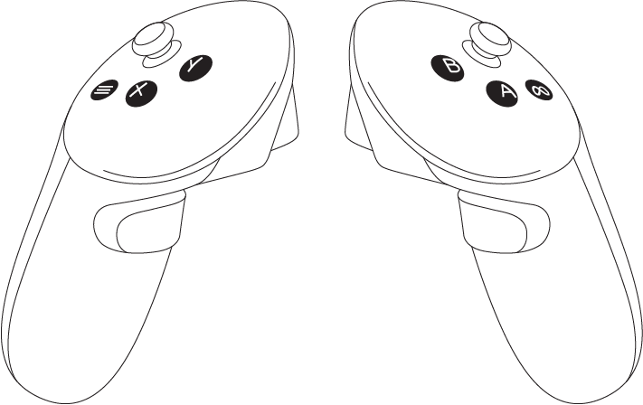

# Quest 3 controller art and button names

[한국어](../ko/CONTROLLER_ART.md) | [English](../en/CONTROLLER_ART.md) | [日本語](../ja/CONTROLLER_ART.md) | [简体中文](../zh-CN/CONTROLLER_ART.md)

The user-selected illustration is pixel-identical to `Meta Quest Touch Plus/Quest_03.png` in the official **Meta Quest Hardware Art 1.8** package. These guides preserve that artwork and place GF2VR instructions around it.

| Location / action | Button names and distinction |
|---|---|
| Left face | X, Y, thumbstick, Menu |
| Right face | A, B, thumbstick, Meta |
| Index Trigger | Front of controller; a different input from Grip |
| Grip | Side button, not the entire handle |
| Stick click | Press the thumbstick down rather than tilting it |

Controller artwork belongs to Facebook Technologies, LLC and its affiliates. It is used to identify the corresponding product in user instructions and does not imply Meta partnership, sponsorship or endorsement. GF2VR action labels and layout are project additions, distinct from Meta platform default controls.

Copyright © Facebook Technologies, LLC and its affiliates. All rights reserved.

- [Meta Quest Hardware Art 1.8](https://developers.meta.com/vr/downloads/package/oculus-controller-art/)
- [Art Attribution License 1.0](https://developers.meta.com/vr/licenses/art-1.0/) · [License notice](../images/META-CONTROLLER-ART-LICENSE.txt)
- [General VR controls](../images/vr-controls-en.png) · [Game-input mode](../images/vr-game-input-en.png) · [GF2VR controls](USAGE.md)
