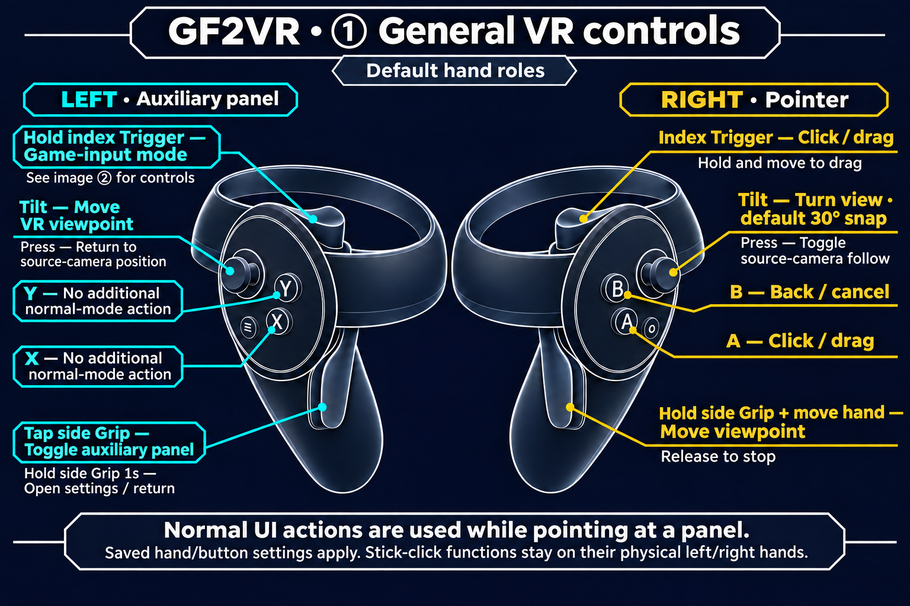
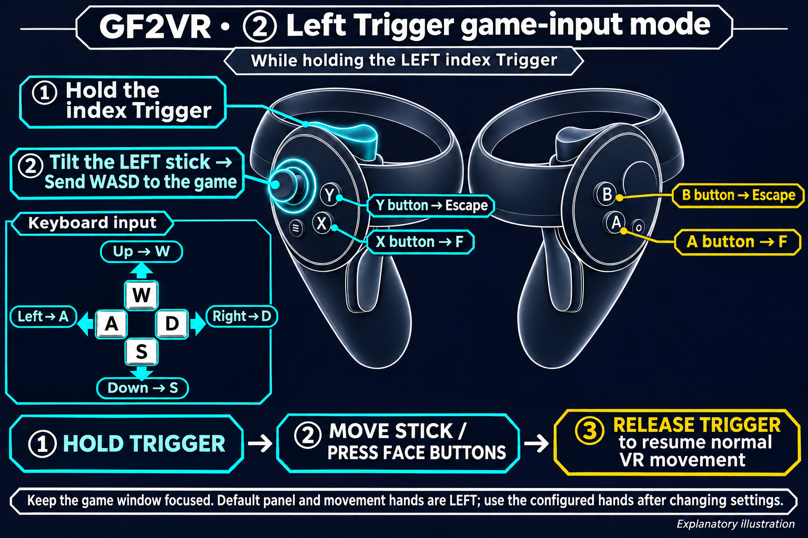
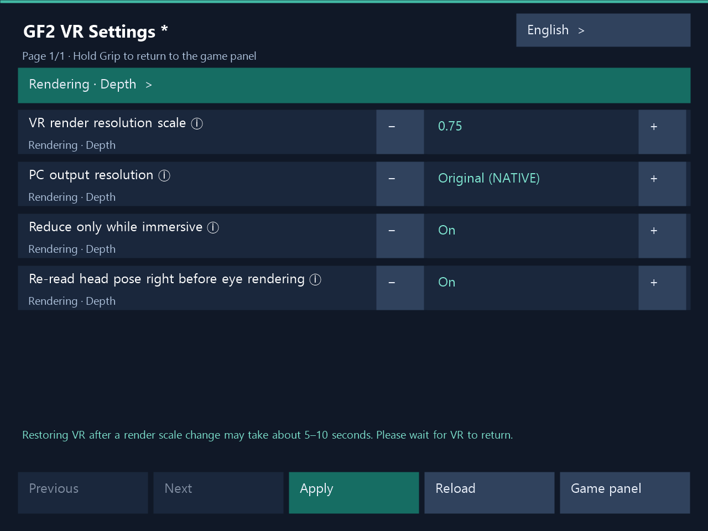

# Starting the game and controller controls

[한국어](../ko/USAGE.md) | [English](../en/USAGE.md) | [日本語](../ja/USAGE.md) | [简体中文](../zh-CN/USAGE.md)

[Home](../../README.en.md)

These instructions use the default hand roles. If you changed roles or buttons, use your saved mappings. Turn off in-game anti-aliasing before using VR.

## VR controls

### ① General VR controls

### ② Left Trigger game-input mode

While holding the left index Trigger, the default movement stick sends WASD to the game instead of moving the VR viewpoint. Up W, down S, left A, right D; X/A sends F and Y/B sends Escape. Release Trigger to return to normal VR movement.

Explanatory illustration using default hand roles. Distinguish the index Trigger from the side Grip. Press a stick down to click it. Stick-click functions remain on their physical left/right hands.

**Hold the right side Grip and move your hand to grab the world and move the viewpoint. Release Grip to stop.**

### X / Y / A / B buttons

These are the default hand-role and button settings. Game-input mode lasts **while holding the left index Trigger**. Use the panel-hand Trigger if the panel hand was changed.

| Button | Normal UI | Game-input mode |
|---|---|---|
| X | No additional binding | F key |
| Y | No additional binding | Escape key |
| A | Click / drag | F key |
| B | Back / cancel | Escape key |

Swapping panel/pointer hands moves normal UI click to X and back to Y. The click/back button-swap setting exchanges normal UI actions. Game-input mode retains physical X/A → F and Y/B → Escape.

The left stick moves and the right stick turns. Right Trigger or A clicks and drags; B goes back. Tap left Grip to toggle the auxiliary panel or hold it for one second to open VR settings. While left Trigger is held, the movement stick sends WASD, X/A sends F and Y/B sends Escape. Hold right Grip and move the hand to drag the world.

**Hold the right side Grip and move your hand to grab the world and move the viewpoint. Release Grip to stop.**

## Startup order

1. Make sure your headset and controllers are connected, then start SteamVR.
2. Save options in the PC configurator if needed. During play, use the PC window or VR panel to apply changes.
3. Start the game as you normally would. The installer does not start it for you.
4. When using controllers to operate the game, make sure the game window is selected on the PC.

Press Save or Apply to update the running game. See [Troubleshooting](TROUBLESHOOTING.md) if needed.

## Front panel and auxiliary panel

Normal menus and 2D screens appear on a front panel. In supported 3D scenes, stereoscopic VR is the main view, and you can open the original game screen as an auxiliary panel when needed.

With the default settings, **left Grip** opens and closes the auxiliary panel in 3D scenes. It does not hide the front panel on normal 2D screens. If you have changed hand roles, use Grip on the hand assigned to the auxiliary panel.

## Basic controls

The following assumes that you have not changed hand roles.

| Control | Action |
|---|---|
| Left stick | Move the VR viewpoint |
| Right stick | Turn the view. The default is snap turning in 30° steps. |
| Right-hand pointer | Point at items on the game screen. |
| Right Trigger or A | Click the pointed item |
| Right B | Back / cancel |
| Left Grip | Short press toggles the auxiliary panel, hold for 1 second to open/leave VR settings |

To snap turn again, return the stick to the center before tilting it again. To drag, hold the click while moving the pointer.

These controls change if you change hand roles or swap the click and Back buttons in settings. The hands used for movement and turning sticks are configured separately from the panel and pointer hands.

## Game control mode: WASD, F and Escape

**Hold Trigger on the auxiliary-panel hand** to enter game control mode. With the default settings, this is left Trigger.

- The movement stick sends **WASD** input to the game instead of moving the VR viewpoint.
- **X or A** sends **F**, and **Y or B** sends **Escape**.
- Release Trigger to return to normal VR movement and UI controls.

You can use this mode without opening the auxiliary panel. This Trigger is separate from the pointer-hand Trigger used for normal UI clicks. If input does not work, first make sure the game window is selected.

## Moving your viewpoint with world grip

World grip defaults ON for new settings and reset. Existing saved values are retained. Change it in PC or VR settings and save/apply.

With the default selection of right Grip and right-hand tracking, hold right Grip and move your hand to adjust your viewpoint as if grabbing and moving the world. Release the button to stop, and press it again to continue.

You can change the activation buttons and tracked hands. However, the auxiliary panel's Grip, the game control mode's Trigger and pointer UI controls can take priority. See the [settings guide](SETTINGS.md) as well.

## Stick clicks: return viewpoint and camera following

The following controls work in the 3D VR view. They mean **pressing the stick down as a button**, rather than tilting it.

| Control | Action |
|---|---|
| Physical left stick click | Returns a viewpoint changed by world grip or stick movement to the current original-camera reference. |
| Physical right stick click | Toggles whether to follow the original camera's movement. |

The left and right click roles do not change when you change the movement-hand setting. Camera following controls whether to follow the original camera's movement; it is separate from looking around with your head or moving manually.

To use world grip again after returning your viewpoint, release any Grip you were holding and press it again. Camera following toggled with right stick click lasts only for the current game session. Save its startup value separately in the configurator for the next launch.

See the [settings guide](SETTINGS.md) for world scale, linked stereo depth and movement speed, and startup camera following.

## In-game VR settings

UI example captured from the actual VR settings panel renderer while editing render scale 0.75. The footer asks the user to wait about 5–10 seconds for recovery.

1. Hold the auxiliary-panel hand’s side Grip for 1 second to open VR settings. The default hand is left. The gesture follows a hand-role swap. A short press and release hides or shows the current auxiliary panel.
2. Select items with the ray and edit values with the ± buttons or numeric keypad, then press **Apply**. Changes reach the running VR mode without restarting the game, with an actual application result. The PC configurator uses the same application path.
3. **After changing render scale, restoring VR stereo may take about 5–10 seconds.** A brief flat view may appear during application. Please wait for VR to return and for the application result. Recovery depends on GPU work finishing, render resources being rebuilt and a new stereo frame becoming ready.
4. Choose **Game panel** or hold Grip again to return to the original game auxiliary panel. Unsaved edits require discard confirmation. Release all buttons before resuming game controls.

While settings are visible, game clicks and keys, locomotion, artificial turning and world grab are blocked. Head and hand tracking remain available. In Dirty, character touch also remains available. If simultaneous PC and VR edits conflict, use **Reload** to read the latest settings before applying. Failed edits remain available for retry.

Korean, English, Japanese and Simplified Chinese are supported. The PC window and VR panel share the language preference in the same installation. The VR settings host reads it when the host starts.

## Character contact (Dirty)

In Dirty, bring a hand near supported chest, butt, face, or thigh regions to make contact. Face and thigh surfaces indent locally and recover after release. Default maximum depths are 8 mm for the face and 6 mm for thighs. Toggle contact visualization in PC or VR settings. It defaults to OFF; cyan means idle and orange means active contact. Existing custom contact targets and saved settings are retained.

Support depends on each character and outfit mesh. Indentation is skipped for meshes that cannot be handled safely. The user visually confirmed face/thigh pressing and restoration and butt exterior contact in a recent Haoplay run. Separate Steam HMD validation of these additions and coverage of every character and outfit remain pending.
