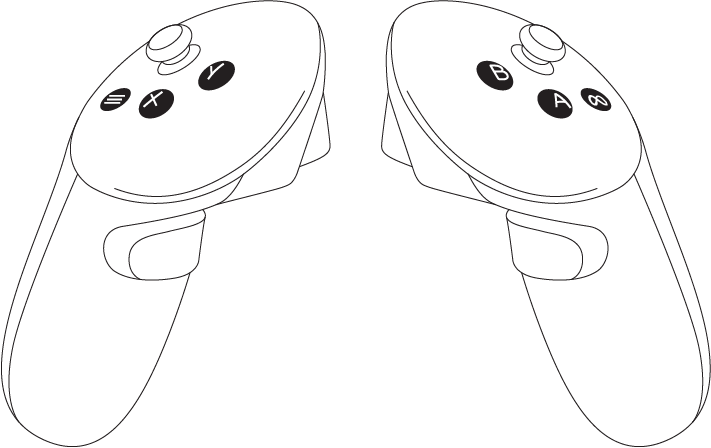

# Quest 3のコントローラー画像とボタン名

[한국어](../ko/CONTROLLER_ART.md) | [English](../en/CONTROLLER_ART.md) | [日本語](../ja/CONTROLLER_ART.md) | [简体中文](../zh-CN/CONTROLLER_ART.md)

ユーザーが指定した原画は公式**Meta Quest Hardware Art 1.8**の`Meta Quest Touch Plus/Quest_03.png`とピクセルが一致します。原画を保持し、周囲にGF2VRの操作説明を配置しています。

| 位置・動作 | ボタン名と区別 |
|---|---|
| 左手の表面 | X、Y、スティック、Menu |
| 右手の表面 | A、B、スティック、Meta |
| 人差し指Trigger | コントローラー前側・Gripとは別入力 |
| Grip | 側面ボタン・持ち手全体の名称ではありません |
| スティッククリック | 傾けるのではなく下へ押し込む操作 |

原画の権利はFacebook Technologies, LLCおよび関連会社に帰属します。該当製品のユーザー向け説明として使用し、Metaとの提携・支援・保証を意味しません。GF2VRの操作説明とレイアウトは本プロジェクトによる追加で、Metaプラットフォームの標準操作とは区別されます。

Copyright © Facebook Technologies, LLC and its affiliates. All rights reserved.

- [Meta Quest Hardware Art 1.8](https://developers.meta.com/vr/downloads/package/oculus-controller-art/)
- [Art Attribution License 1.0](https://developers.meta.com/vr/licenses/art-1.0/) · [License notice](../images/META-CONTROLLER-ART-LICENSE.txt)
- [General VR controls](../images/vr-controls-ja.png) · [Game-input mode](../images/vr-game-input-ja.png) · [GF2VR controls](USAGE.md)
