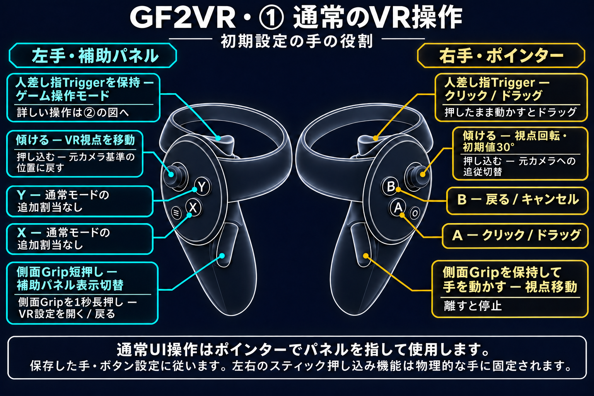
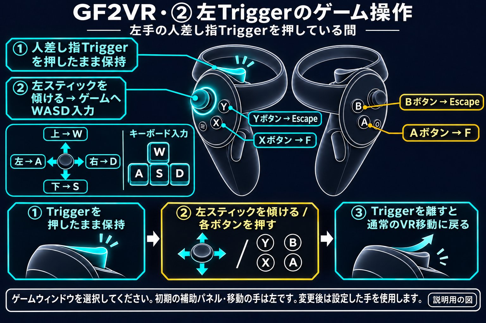
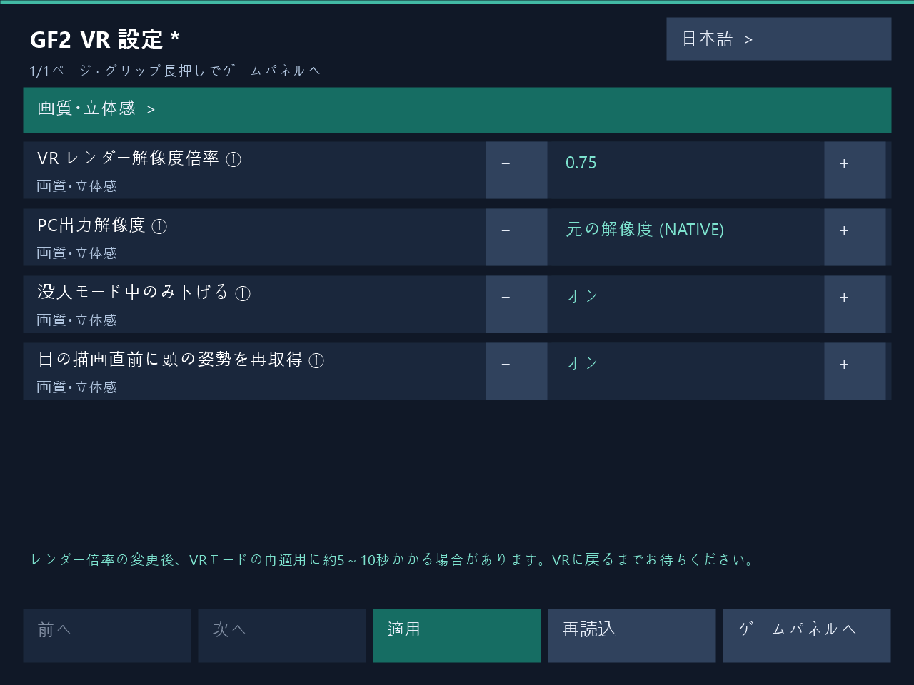

# ゲームの起動とコントローラー操作

[한국어](../ko/USAGE.md) | [English](../en/USAGE.md) | [日本語](../ja/USAGE.md) | [简体中文](../zh-CN/USAGE.md)

[トップ](../../README.ja.md)

以下は初期の手の役割での説明です。役割やボタンを変更した場合は保存した割り当てを使ってください。VR 使用前にゲーム内アンチエイリアスを OFF にしてください。

## VR操作ガイド

### ① 通常のVR操作

### ② 左Triggerのゲーム操作

左手の人差し指Triggerを押している間、初期設定の移動スティックはゲームへWASD入力を送信します。上W・下S・左A・右D、X/AはF、Y/BはEscapeです。Triggerを離すと通常のVR移動に戻ります。

初期設定の手の役割を示す説明用の図です。人差し指のTriggerと側面Gripを区別してください。押し込みはスティックを下に押す操作です。左右の押し込み機能は物理的な手に固定されます。

**右手の側面Gripを保持して手を動かすと、ワールドをつかんで視点を移動できます。Gripを離すと停止します。**

### X・Y・A・Bボタン

初期設定の手の役割・ボタン割当です。ゲーム操作モードは**左手の人差し指Triggerを押している間**に動作します。補助パネル側の手を変更した場合は、その手のTriggerを使用します。

| ボタン | 通常UI操作 | ゲーム操作モード |
|---|---|---|
| X | 追加割当なし | Fキー |
| Y | 追加割当なし | Escapeキー |
| A | クリック・ドラッグ | Fキー |
| B | 戻る・キャンセル | Escapeキー |

パネル・ポインターの手を交換すると、通常UIはXがクリック、Yが戻るになります。クリック・戻るのボタン交換設定は通常UI操作に適用されます。ゲーム操作モードの物理ボタンX/A → F、Y/B → Escapeは固定です。

左スティックで移動、右スティックで回転します。右TriggerまたはAでクリック・ドラッグ、Bで戻ります。左Gripを短押しすると補助パネルを切り替え、1秒長押しするとVR設定が開きます。左Triggerを押している間、移動スティックはWASD、X/AはF、Y/BはEscapeを送信します。右Gripを保持して手を動かすとワールドグリップで視点を移動します。

**右手の側面Gripを保持して手を動かすと、ワールドをつかんで視点を移動できます。Gripを離すと停止します。**

## 起動手順

1. ヘッドセットとコントローラーが接続されていることを確認し、SteamVR を起動します。
2. 必要に応じてPC設定画面で保存します。ゲーム中もPC画面やVRパネルから適用できます。
3. 普段の方法でゲームを起動します。インストーラーがゲームを代わりに起動することはありません。
4. コントローラーでゲームを操作するときは、PC 上でゲームウィンドウが選択されていることを確認します。

編集後に保存・適用して実行中のゲームに反映できます。必要に応じて[トラブルシューティング](TROUBLESHOOTING.md)を参照してください。

## 正面パネルと補助パネル

通常のメニューや 2D 画面は、前方の正面パネルに表示されます。対応する 3D シーンでは立体映像が主画面になり、必要に応じて元のゲーム画面を補助パネルとして開けます。

既定では、**左手の Grip** で 3D 画面の補助パネルを開閉します。この操作で通常の 2D 画面の正面パネルが非表示になることはありません。手の役割を変更した場合は、補助パネルを担当する手の Grip を使ってください。

## 基本操作

以下は、手の役割を変更していない場合の操作です。

| 操作 | 動作 |
|---|---|
| 左スティック | VR 視点の移動 |
| 右スティック | 視野の回転。既定では一度に 30° ずつ回るスナップ方式 |
| 右手のポインター | ゲーム画面の項目を指します。 |
| 右手の Trigger または A | 指している項目をクリック |
| 右手の B | 戻る・キャンセル |
| 左手の Grip | 短押しで補助パネル表示切替、1秒長押しでVR設定を開く・戻る |

再びスナップ回転するには、スティックを中央に戻してからもう一度倒します。クリックを押したままポインターを動かすと、ドラッグできます。

設定で手の役割やクリック・戻るボタンを変更すると、操作も変わります。移動・回転スティックの手と、パネル・ポインターの手は、それぞれ別に設定します。

## ゲーム操作モード: WASD・F・Escape

**補助パネルを担当する手の Trigger を押している間**、ゲーム操作モードに切り替わります。既定では左手の Trigger です。

- 移動スティックは、VR 視点の移動ではなく、ゲームの **WASD** 入力に使用されます。
- **X または A** は **F**、**Y または B** は **Escape** を入力します。
- Trigger を離すと、通常の VR 移動と UI 操作に戻ります。

補助パネルを画面に開いていなくても、このモードを使用できます。通常の UI クリックに使うポインター側の Trigger とは別です。入力されない場合は、まずゲームウィンドウが選択されているか確認してください。

## ワールドグリップで視点を移動する

ワールドグリップは既定ではオフです。PC画面またはVR設定で有効にし、保存・適用してください。

既定の選択である右 Grip と右手の追跡を使う場合、右 Grip を押したまま手を動かすと、世界をつかんで動かすように視点を調整できます。ボタンを離すと停止し、もう一度押すと引き続き操作できます。

起動ボタンや追跡する手は変更できます。ただし、補助パネルの Grip、ゲーム操作モードの Trigger、ポインターの UI 操作が優先される場合があるため、[設定ガイド](SETTINGS.md)も確認してください。

## スティック押し込みによる視点と追従の調整

以下の操作は、3D VR 画面で使います。スティックを倒す操作ではなく、**ボタンのように下へ押し込む**操作です。

| 操作 | 動作 |
|---|---|
| 物理的な左スティックの押し込み | ワールドグリップやスティック移動で変更した視点を、現在の元のカメラを基準に戻します。 |
| 物理的な右スティックの押し込み | 元のカメラの動きへの追従をオン・オフします。 |

移動に使う手の設定を変更しても、左右の押し込み操作の役割は変わりません。カメラ追従は元のカメラの動きに従うかを決めるもので、頭で周囲を見回したり自分で移動したりする操作とは別です。

視点を戻した後でワールドグリップを再び使うには、押していた Grip を一度離してから押し直してください。右スティックの押し込みで変更した追従状態は、現在のゲーム実行中にのみ適用されます。次回起動時の状態は、設定プログラムで別途保存します。

ワールドの大きさ・立体感・移動速度の連動と、起動時の追従設定については、[設定ガイド](SETTINGS.md)を確認してください。

## ゲーム内VR設定

実際のVR設定パネルレンダラーで生成したUI例です。レンダー倍率0.75を編集中で、下部に約5～10秒の復帰待ち案内が表示されています。

1. 補助パネル側の手の側面Gripを1秒長押しするとVR設定が開きます。既定は左手で、手の役割を交換すると操作側も移ります。短く押して離すと現在の補助パネルを表示または非表示にします。
2. レイで項目を選び、±ボタンや数値キーパッドで編集して**適用**を押します。ゲームを再起動せず実行中のVRに反映し、適用結果を表示します。PC設定画面も同じ適用経路を使います。
3. **レンダー倍率の変更後、VRステレオの復元に約5～10秒かかる場合があります。** 適用中は一時的にフラット表示になることがあります。VRの復帰と適用結果をお待ちください。復帰時間はGPU処理の終了、描画リソースの再構築、新しいステレオフレームの準備によって変わります。
4. **ゲームパネルへ**または再度のGrip長押しで元の補助パネルに戻ります。未適用の編集には破棄確認が表示されます。すべてのボタンを離してからゲーム操作を再開してください。

設定表示中はゲームのクリック・キー入力、移動・人工回転・ワールドグリップを停止します。頭と手の追跡を維持し、Dirtyではキャラクターへのタッチも維持します。PCとVRの同時編集が競合した場合は**再読込**で最新の設定を読み込んでください。失敗した編集値は再試行用に保持します。

韓国語・英語・日本語・簡体字中国語に対応します。同じインストール先のPC画面とVRパネルで言語設定を共有し、VR設定ホストの起動時に読み込みます。

## キャラクター接触（Dirty）

Dirty版では、対応するキャラクターの胸・お尻・顔・左右の太ももに手を近づけると接触を判定します。顔と太ももは接触周辺がへこみ、手を離すと復元されます。標準の最大量は顔8mm、太もも6mmです。接触位置表示はPCまたはVR設定で切り替えられ、初期値はOFFです。水色は非接触、オレンジ色は接触中です。既存のカスタム接触対象と保存設定は維持されます。

対応範囲はキャラクターや衣装のメッシュ構成によって異なります。安全に処理できないメッシュには押し込みを適用しません。最近のHaoplay実機で顔・太ももの押し込みと復元、お尻の外側接触が正常であることをユーザーが確認しました。追加機能のSteam HMD検証と全キャラクター・衣装の検証は未完了です。
