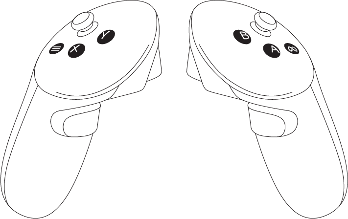

# Quest 3 컨트롤러 이미지와 버튼 이름

[한국어](../ko/CONTROLLER_ART.md) | [English](../en/CONTROLLER_ART.md) | [日本語](../ja/CONTROLLER_ART.md) | [简体中文](../zh-CN/CONTROLLER_ART.md)

사용자가 지정한 원화는 Meta 공식 **Meta Quest Hardware Art 1.8**의 `Meta Quest Touch Plus/Quest_03.png`와 픽셀이 일치합니다. 본 안내는 그 원화를 보존해 사용하고, GF2VR 조작 설명을 주변에 배치했습니다.

| 위치 / 동작 | 버튼 이름과 구분 |
|---|---|
| 왼손 앞면 | X, Y, 스틱, Menu |
| 오른손 앞면 | A, B, 스틱, Meta |
| 검지 Trigger | 컨트롤러 앞쪽 · Grip과 다른 입력 |
| Grip | 컨트롤러 옆면 · 손잡이 전체를 뜻하지 않음 |
| 스틱 클릭 | 스틱을 기울이지 않고 아래로 누르기 |

원화의 권리는 Facebook Technologies, LLC 및 관계사에 있습니다. 해당 제품을 설명하는 사용자 안내 용도로 사용하며, Meta의 제휴·후원·보증을 의미하지 않습니다. GF2VR 조작 설명과 배치는 프로젝트가 추가한 내용이며 Meta의 기본 버튼 동작 안내와 구분합니다.

Copyright © Facebook Technologies, LLC and its affiliates. All rights reserved.

- [Meta Quest Hardware Art 1.8](https://developers.meta.com/vr/downloads/package/oculus-controller-art/)
- [Art Attribution License 1.0](https://developers.meta.com/vr/licenses/art-1.0/) · [License notice](../images/META-CONTROLLER-ART-LICENSE.txt)
- [General VR controls](../images/vr-controls-ko.png) · [Game-input mode](../images/vr-game-input-ko.png) · [GF2VR controls](USAGE.md)
