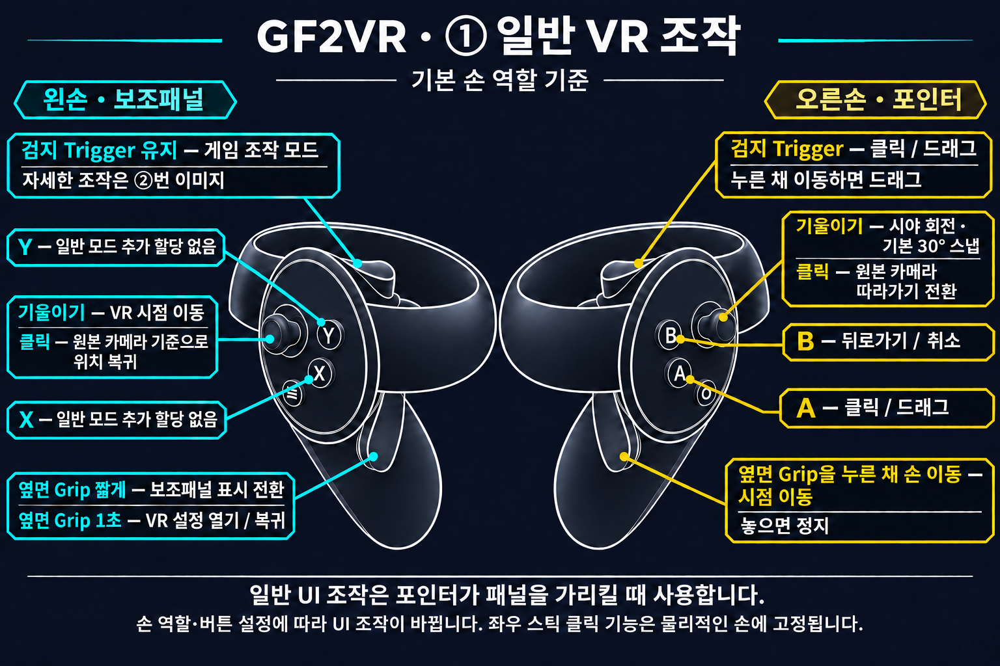
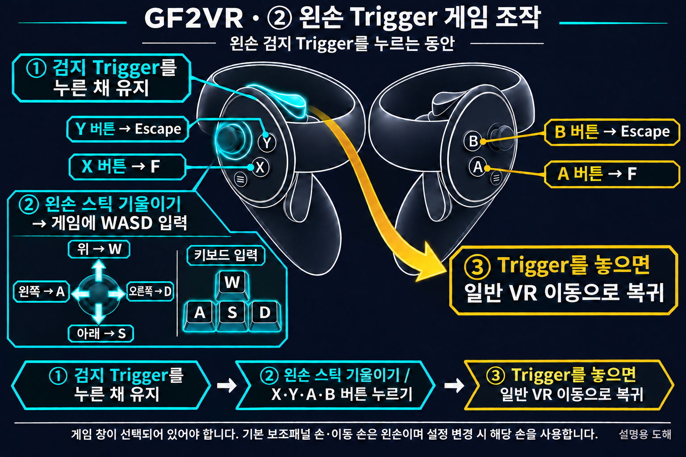
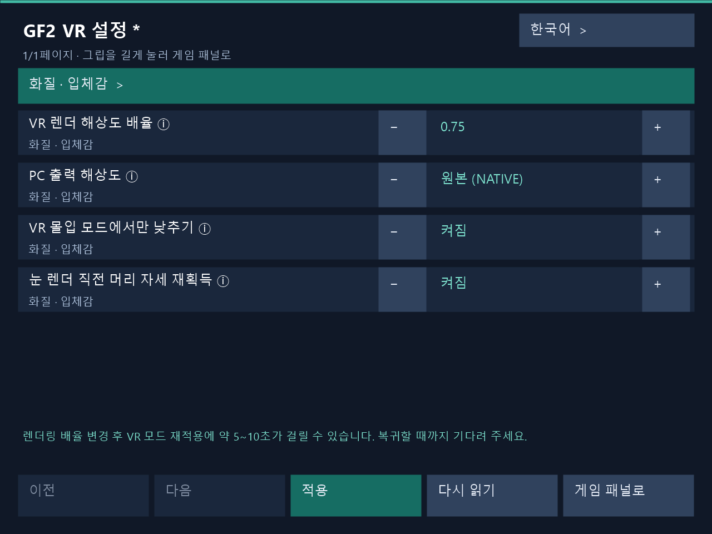

# 게임 실행과 컨트롤러 조작

[한국어](../ko/USAGE.md) | [English](../en/USAGE.md) | [日本語](../ja/USAGE.md) | [简体中文](../zh-CN/USAGE.md)

[처음으로](../../README.md)

아래 조작은 기본 손 역할을 기준으로 합니다. 손 역할과 버튼을 바꾸었다면 저장한 설정을 따릅니다. VR을 사용하기 전에 게임의 안티앨리어싱을 끄세요.

## VR 모드 조작법

### ① 일반 VR 조작

### ② 왼손 Trigger 게임 조작

왼손 검지 Trigger를 누르는 동안 기본 이동 스틱은 VR 시점 이동 대신 게임에 WASD 입력을 보냅니다. 위 W·아래 S·왼쪽 A·오른쪽 D이며, X·A는 F, Y·B는 Escape를 입력합니다. Trigger를 놓으면 일반 VR 이동으로 돌아갑니다.

기본 손 역할을 기준으로 한 설명용 도해입니다. 검지 Trigger와 옆면 Grip을 구분하세요. 스틱 클릭은 아래로 누르는 동작이며 좌우 클릭 기능은 물리적인 손에 고정됩니다.

**오른손 옆면 Grip을 누른 채 손을 움직이면 월드를 잡아 시점을 옮기고, Grip을 놓으면 멈춥니다.**

### X·Y·A·B 버튼

기본 손 역할·버튼 설정을 기준으로 합니다. 게임 조작 모드는 **왼손 검지 Trigger를 누르는 동안** 작동합니다. 보조패널 손을 바꾸었다면 해당 손의 Trigger를 사용합니다.

| 버튼 | 일반 조작 | 게임 조작 모드 |
|---|---|---|
| X | 별도 할당 없음 | F 입력 |
| Y | 별도 할당 없음 | Escape 입력 |
| A | 클릭·드래그 | F 입력 |
| B | 뒤로가기·취소 | Escape 입력 |

패널·포인터 손 역할을 교환하면 일반 UI 조작은 X가 클릭, Y가 뒤로가기로 바뀝니다. 클릭·뒤로가기 버튼 교환 설정은 일반 UI 동작에 적용됩니다. 게임 조작 모드의 물리 버튼 X·A → F, Y·B → Escape는 그대로입니다.

왼손 스틱은 이동, 오른손 스틱은 회전입니다. 오른손 Trigger 또는 A로 클릭·드래그하고 B로 뒤로 갑니다. 왼손 Grip은 짧게 눌러 보조패널을 전환하고 1초 눌러 VR 설정을 엽니다. 왼손 Trigger를 누르는 동안 이동 스틱은 WASD, X/A는 F, Y/B는 Escape로 동작합니다. 오른손 Grip을 누른 채 손을 움직이면 월드 그립으로 시점을 옮깁니다.

**오른손 옆면 Grip을 누른 채 손을 움직이면 월드를 잡아 시점을 옮기고, Grip을 놓으면 멈춥니다.**

## 실행 순서

1. 헤드셋과 컨트롤러가 연결되어 있는지 확인하고 SteamVR를 실행합니다.
2. 필요하면 PC 설정창에서 옵션을 저장합니다. 게임 실행 중에는 PC 창이나 VR 패널에서 적용할 수 있습니다.
3. 평소 사용하던 방법으로 게임을 실행합니다. 인스톨러가 게임을 대신 실행하지는 않습니다.
4. 컨트롤러로 게임을 조작할 때는 PC에서 게임 창이 선택되어 있는지 확인합니다.

편집 후 저장/적용으로 실행 중인 게임에 반영할 수 있습니다. 문제가 있으면 [문제 해결 안내](TROUBLESHOOTING.md)를 참고하세요.

## 정면 패널과 보조 패널

일반 메뉴나 2D 화면은 앞쪽의 정면 패널로 표시합니다. 지원되는 3D 장면에서는 입체 화면이 주 화면이 되고, 필요할 때 원본 게임 화면을 보조 패널로 열 수 있습니다.

기본 설정에서는 **왼손 Grip**으로 3D 화면의 보조 패널을 열고 닫습니다. 이 조작으로 일반 2D 화면의 정면 패널을 숨기지는 않습니다. 손 역할을 바꾸었다면 보조 패널을 맡은 손의 Grip을 사용하세요.

## 기본 조작

다음은 손 역할을 바꾸지 않았을 때의 기준입니다.

| 조작 | 동작 |
|---|---|
| 왼쪽 스틱 | VR 시점 이동 |
| 오른쪽 스틱 | 시야 회전. 기본은 한 번에 30°씩 도는 스냅 방식 |
| 오른손 포인터 | 게임 화면의 항목을 가리킵니다. |
| 오른손 Trigger 또는 A | 가리킨 항목 클릭 |
| 오른손 B | 뒤로 가기·취소 |
| 왼손 Grip | 짧게 눌러 보조패널 표시 전환, 1초 길게 눌러 VR 설정 열기/복귀 |

스냅 회전을 다시 하려면 스틱을 가운데로 놓았다가 다시 기울입니다. 클릭을 누른 채 포인터를 움직이면 드래그할 수 있습니다.

설정에서 손 역할이나 클릭·뒤로가기 버튼을 바꾸면 달라집니다. 이동·회전 스틱의 손과 패널·포인터의 손은 각각 따로 설정합니다.

## 게임 조작 모드: WASD·F·Escape

**보조 패널을 담당하는 손의 Trigger를 누르고 있는 동안** 게임 조작 모드로 전환합니다. 기본 설정에서는 왼손 Trigger입니다.

- 이동 스틱은 VR 시점 이동 대신 게임의 **WASD** 입력에 사용합니다.
- **X 또는 A**는 **F**, **Y 또는 B**는 **Escape**를 입력합니다.
- Trigger에서 손을 떼면 원래의 VR 이동과 일반 UI 조작으로 돌아갑니다.

보조 패널을 화면에 열어 두지 않아도 이 모드를 사용할 수 있습니다. 일반 UI 클릭용 포인터 손 Trigger와 구별하세요. 입력이 안 되면 게임 창이 선택되어 있는지 먼저 확인합니다.

## 월드 그립으로 시점 옮기기

월드 그립은 기본적으로 켜져 있습니다. 이미 저장된 ON/OFF는 유지되며, PC 설정창이나 VR 설정에서 바꾸고 저장/적용할 수 있습니다.

기본 선택인 오른쪽 Grip과 오른손 추적을 사용할 경우, 오른쪽 Grip을 누른 채 손을 움직이면 세계를 잡아 옮기는 느낌으로 시점을 조절합니다. 버튼을 놓으면 멈추고, 다시 누르면 이어서 조작할 수 있습니다.

활성화 버튼이나 추적할 손을 바꿀 수 있습니다. 다만 보조 패널의 Grip, 게임 조작 모드의 Trigger, 포인터 UI 조작이 우선하는 경우가 있으므로 [설정 안내](SETTINGS.md)도 함께 확인하세요.

## 스틱 클릭으로 시점과 따라가기 조절

아래 조작은 3D VR 화면에서 사용합니다. 스틱을 기울이는 것이 아니라 **버튼처럼 아래로 눌러 클릭**하는 동작입니다.

| 조작 | 동작 |
|---|---|
| 물리적인 왼쪽 스틱 클릭 | 월드 그립이나 스틱 이동으로 바꾼 시점을 현재 원본 카메라 기준으로 되돌립니다. |
| 물리적인 오른쪽 스틱 클릭 | 원래 카메라의 움직임을 따라갈지 켜고 끕니다. |

이동 손 설정을 바꾸어도 왼쪽·오른쪽 클릭의 역할은 바뀌지 않습니다. 카메라 따라가기는 원래 카메라의 움직임을 따를지 정하는 옵션이며, 머리로 둘러보기나 직접 이동하는 조작과는 별개입니다.

시점을 되돌린 뒤 월드 그립을 다시 쓰려면 누르고 있던 Grip을 놓았다가 다시 누르세요. 오른쪽 스틱 클릭으로 바꾼 따라가기 상태는 현재 게임에만 적용됩니다. 다음 실행의 시작값은 설정 프로그램에서 따로 저장합니다.

월드 크기·입체감·이동 속도 연동과 시작 시 따라가기 설정은 [설정 안내](SETTINGS.md)에서 확인할 수 있습니다.

## 인게임 VR 설정

실제 VR 설정 패널 렌더러로 생성한 UI 예시입니다. 렌더링 배율 0.75를 편집 중이며 하단에 약 5~10초의 복원 대기 안내가 표시됩니다.

1. 보조패널 손의 옆면 Grip을 1초 누르면 VR 설정 화면이 열립니다. 기본은 왼손이며 손 역할을 교환하면 해당 손을 사용합니다. 짧게 눌렀다 놓으면 현재 보조패널을 숨기거나 표시합니다.
2. 레이로 항목을 선택하고 ± 버튼 또는 숫자 키패드로 값을 편집한 뒤 **적용**을 누릅니다. 게임을 재실행하지 않고 실행 중인 VR에 반영하며 실제 적용 결과를 표시합니다. PC 설정창도 같은 적용 경로를 사용합니다.
3. **렌더링 배율을 변경하면 VR 스테레오가 복원되기까지 약 5~10초가 걸릴 수 있습니다.** 적용 중 잠시 플랫 화면으로 바뀔 수 있습니다. VR이 복귀하고 적용 결과가 나올 때까지 기다려 주세요. 복귀 시간은 GPU 작업 정리와 렌더 자원 재구성, 새 스테레오 프레임 준비에 따라 달라집니다.
4. **게임 패널로** 또는 다시 긴 Grip으로 원래 게임 보조패널에 돌아갑니다. 미적용 변경이 있으면 폐기를 확인합니다. 버튼을 모두 놓은 뒤 게임 조작을 재개하세요.

설정 화면이 보이는 동안 게임 클릭·키 입력, 이동·인공 회전·월드 그립은 잠깁니다. 머리·손 추적을 유지하며 Dirty의 캐릭터 터치도 유지됩니다. PC와 VR에서 동시에 편집해 충돌하면 **다시 읽기**로 최신 설정을 불러온 뒤 적용하세요. 실패한 편집값은 재시도를 위해 유지됩니다.

한국어·영어·일본어·중국어 간체를 지원합니다. PC 설정창과 VR 패널은 같은 설치 폴더의 언어 설정을 사용하며 VR 설정 호스트가 시작될 때 저장된 언어를 읽습니다.
