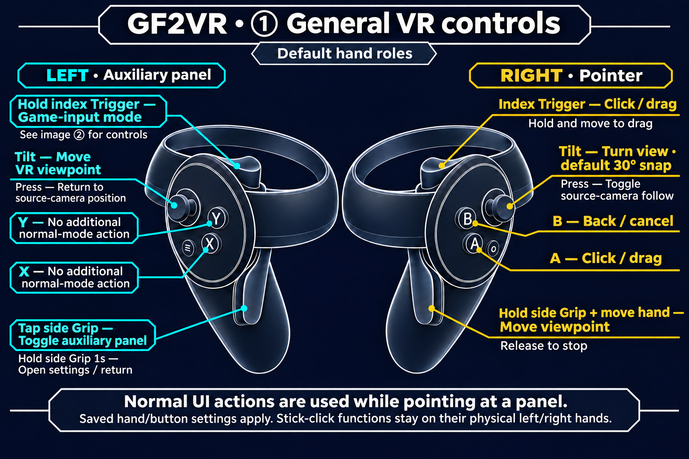
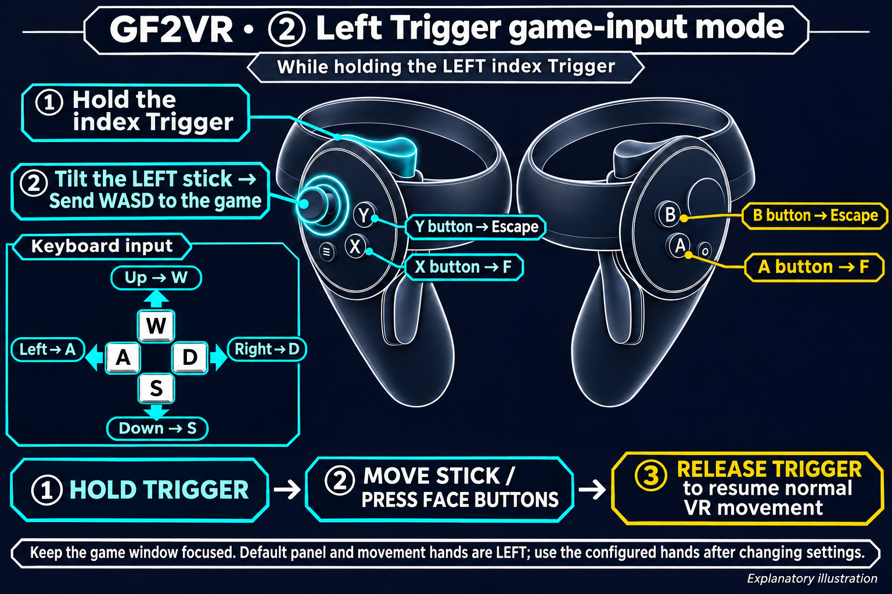

# GF2VR 1.3.10

[한국어](1.3.10.ko.md) | [English](1.3.10.en.md) | [日本語](1.3.10.ja.md) | [简体中文](1.3.10.zh-CN.md)

## Changes

- Improved character contact judgment to reflect body and clothing surfaces.
- Fixed contact releasing while pressing the hand inward.
- Added live contact visualization. Cyan means idle and orange means active contact. Toggle it from PC or VR settings. Its default is OFF.
- Changed the world-drag default to ON while preserving existing saved settings.
- Added four-language illustrations covering general VR controls.

## VR controls

### ① General VR controls

### ② Left Trigger game-input mode

While holding the left index Trigger, the default movement stick sends WASD to the game instead of moving the VR viewpoint. Up W, down S, left A, right D; X/A sends F and Y/B sends Escape. Release Trigger to return to normal VR movement.

Explanatory illustration using default hand roles. Distinguish the index Trigger from the side Grip. Press a stick down to click it. Stick-click functions remain on their physical left/right hands.

**Hold the right side Grip and move your hand to grab the world and move the viewpoint. Release Grip to stop.**

### X / Y / A / B buttons

These are the default hand-role and button settings. Game-input mode lasts **while holding the left index Trigger**. Use the panel-hand Trigger if the panel hand was changed.

| Button | Normal UI | Game-input mode |
|---|---|---|
| X | No additional binding | F key |
| Y | No additional binding | Escape key |
| A | Click / drag | F key |
| B | Back / cancel | Escape key |

Swapping panel/pointer hands moves normal UI click to X and back to Y. The click/back button-swap setting exchanges normal UI actions. Game-input mode retains physical X/A → F and Y/B → Escape.

The left stick moves and the right stick turns. Right Trigger or A clicks and drags; B goes back. Tap left Grip to toggle the auxiliary panel or hold it for one second to open VR settings. While left Trigger is held, the movement stick sends WASD, X/A sends F and Y/B sends Escape. Hold right Grip and move the hand to drag the world.

World drag defaults ON for new settings and reset. Existing saved ON/OFF values survive updates. Changed hand roles and buttons follow saved settings.

Contact improvements and visualization are provided in Dirty. Surface correction may be limited by a character or outfit mesh layout or active morphs. The user confirmed the requested contact entry, inward hold, separation and reentry flow. This does not establish individual coverage of all characters, contexts or both platforms. The world-drag default change passed automated checks and has no separate HMD test.
