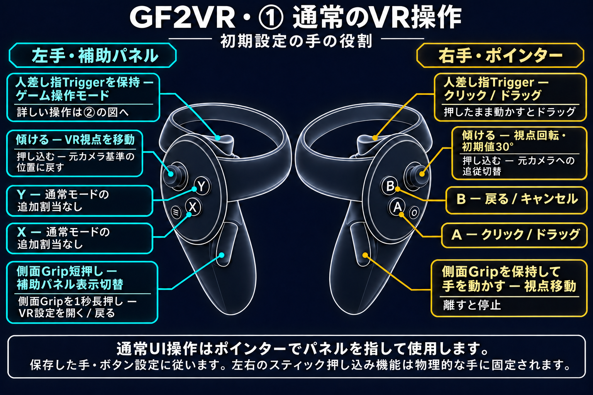
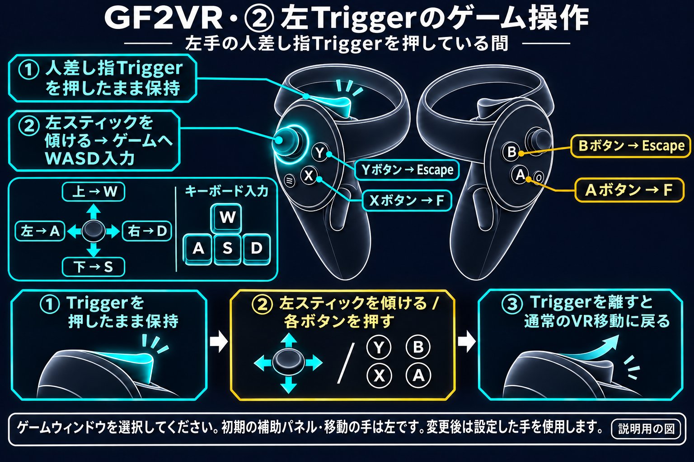

# GF2VR 1.3.10

[한국어](1.3.10.ko.md) | [English](1.3.10.en.md) | [日本語](1.3.10.ja.md) | [简体中文](1.3.10.zh-CN.md)

## 変更内容

- 身体・衣装の表面を反映するようキャラクターの接触判定を改善しました。
- 手を内側へ押し込むと接触が解除される問題を修正しました。
- 接触判定の表示を追加しました。シアンは非接触、オレンジは接触中です。PC・VR設定からリアルタイムに切り替えられ、初期値はOFFです。
- ワールドグリップの初期値をONに変更しました。保存済み設定は保持されます。
- VR全体の操作図を4言語で追加しました。

## VR操作ガイド

### ① 通常のVR操作

### ② 左Triggerのゲーム操作

左手の人差し指Triggerを押している間、初期設定の移動スティックはゲームへWASD入力を送信します。上W・下S・左A・右D、X/AはF、Y/BはEscapeです。Triggerを離すと通常のVR移動に戻ります。

初期設定の手の役割を示す説明用の図です。人差し指のTriggerと側面Gripを区別してください。押し込みはスティックを下に押す操作です。左右の押し込み機能は物理的な手に固定されます。

**右手の側面Gripを保持して手を動かすと、ワールドをつかんで視点を移動できます。Gripを離すと停止します。**

### X・Y・A・Bボタン

初期設定の手の役割・ボタン割当です。ゲーム操作モードは**左手の人差し指Triggerを押している間**に動作します。補助パネル側の手を変更した場合は、その手のTriggerを使用します。

| ボタン | 通常UI操作 | ゲーム操作モード |
|---|---|---|
| X | 追加割当なし | Fキー |
| Y | 追加割当なし | Escapeキー |
| A | クリック・ドラッグ | Fキー |
| B | 戻る・キャンセル | Escapeキー |

パネル・ポインターの手を交換すると、通常UIはXがクリック、Yが戻るになります。クリック・戻るのボタン交換設定は通常UI操作に適用されます。ゲーム操作モードの物理ボタンX/A → F、Y/B → Escapeは固定です。

左スティックで移動、右スティックで回転します。右TriggerまたはAでクリック・ドラッグ、Bで戻ります。左Gripを短押しすると補助パネルを切り替え、1秒長押しするとVR設定が開きます。左Triggerを押している間、移動スティックはWASD、X/AはF、Y/BはEscapeを送信します。右Gripを保持して手を動かすとワールドグリップで視点を移動します。

ワールドグリップは新規設定・初期値へのリセットでONです。保存済みのON/OFFは更新後も保持されます。手の役割やボタンを変更した場合は保存設定に従います。

接触改善と表示はDirty版で利用できます。キャラクター・衣装のメッシュ構成や有効なモーフにより表面補正が制限される場合があります。依頼した接触開始・内側での維持・離脱・再接触はユーザーが確認しました。全キャラクター・全場面や両プラットフォームの個別実機確認を示すものではありません。ワールドグリップ初期値の変更は自動検証済みで、別途HMD実機テストは行っていません。
