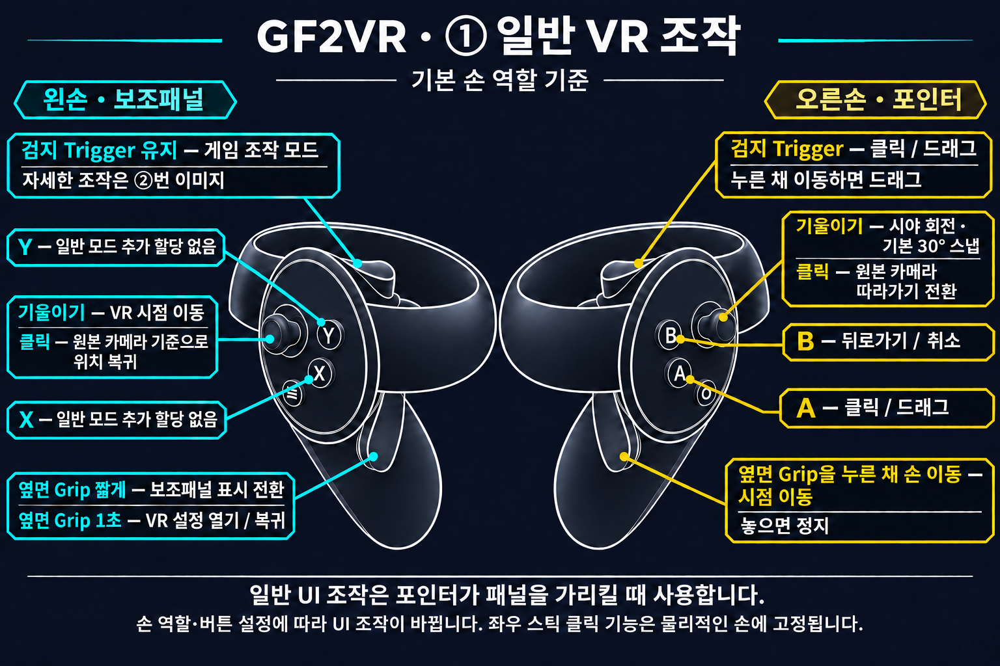
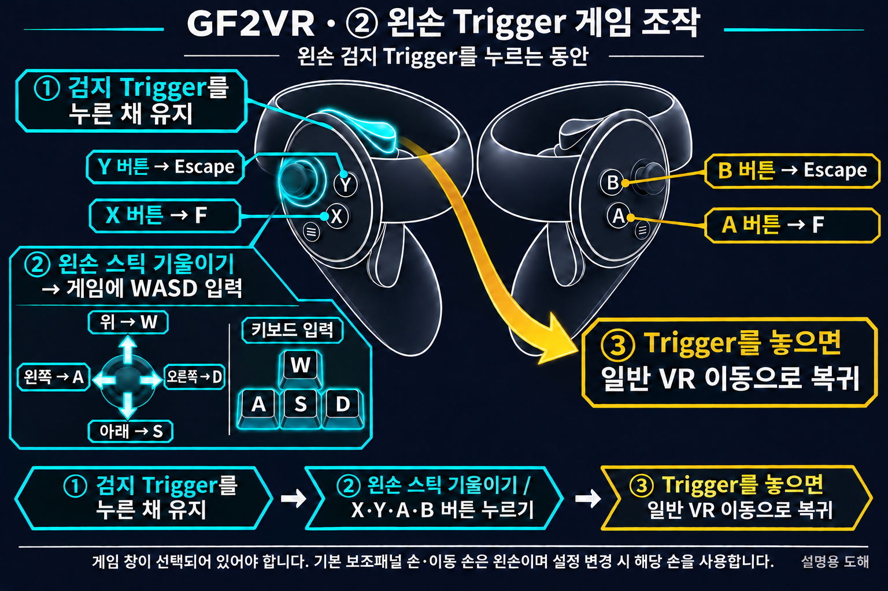

# GF2VR 1.3.10

[한국어](1.3.10.ko.md) | [English](1.3.10.en.md) | [日本語](1.3.10.ja.md) | [简体中文](1.3.10.zh-CN.md)

## 변경 사항

- 몸과 의상 표면을 반영하도록 캐릭터 접촉 판정을 개선했습니다.
- 손을 안쪽으로 눌렀을 때 접촉이 중간에 해제되는 문제를 수정했습니다.
- 접촉 판정 영역 표시를 추가했습니다. 청록색은 비접촉, 주황색은 접촉 중이며 PC/VR 설정에서 실시간으로 켜고 끌 수 있습니다. 표시의 기본값은 OFF입니다.
- 월드 그립 기본값을 ON으로 변경했습니다. 기존에 저장한 설정은 유지합니다.
- VR 모드 전체 조작 안내 이미지를 네 언어로 추가했습니다.

## VR 모드 조작법

### ① 일반 VR 조작

### ② 왼손 Trigger 게임 조작

왼손 검지 Trigger를 누르는 동안 기본 이동 스틱은 VR 시점 이동 대신 게임에 WASD 입력을 보냅니다. 위 W·아래 S·왼쪽 A·오른쪽 D이며, X·A는 F, Y·B는 Escape를 입력합니다. Trigger를 놓으면 일반 VR 이동으로 돌아갑니다.

기본 손 역할을 기준으로 한 설명용 도해입니다. 검지 Trigger와 옆면 Grip을 구분하세요. 스틱 클릭은 아래로 누르는 동작이며 좌우 클릭 기능은 물리적인 손에 고정됩니다.

**오른손 옆면 Grip을 누른 채 손을 움직이면 월드를 잡아 시점을 옮기고, Grip을 놓으면 멈춥니다.**

### X·Y·A·B 버튼

기본 손 역할·버튼 설정을 기준으로 합니다. 게임 조작 모드는 **왼손 검지 Trigger를 누르는 동안** 작동합니다. 보조패널 손을 바꾸었다면 해당 손의 Trigger를 사용합니다.

| 버튼 | 일반 조작 | 게임 조작 모드 |
|---|---|---|
| X | 별도 할당 없음 | F 입력 |
| Y | 별도 할당 없음 | Escape 입력 |
| A | 클릭·드래그 | F 입력 |
| B | 뒤로가기·취소 | Escape 입력 |

패널·포인터 손 역할을 교환하면 일반 UI 조작은 X가 클릭, Y가 뒤로가기로 바뀝니다. 클릭·뒤로가기 버튼 교환 설정은 일반 UI 동작에 적용됩니다. 게임 조작 모드의 물리 버튼 X·A → F, Y·B → Escape는 그대로입니다.

왼손 스틱은 이동, 오른손 스틱은 회전입니다. 오른손 Trigger 또는 A로 클릭·드래그하고 B로 뒤로 갑니다. 왼손 Grip은 짧게 눌러 보조패널을 전환하고 1초 눌러 VR 설정을 엽니다. 왼손 Trigger를 누르는 동안 이동 스틱은 WASD, X/A는 F, Y/B는 Escape로 동작합니다. 오른손 Grip을 누른 채 손을 움직이면 월드 그립으로 시점을 옮깁니다.

월드 그립은 새 설정과 기본값 복원에서 ON입니다. 이미 저장된 ON/OFF는 업데이트 후에도 유지됩니다. 손 역할·버튼을 바꾸면 저장한 설정을 따릅니다.

접촉 개선과 표시는 Dirty 버전에 제공됩니다. 일부 캐릭터·의상의 메시 구성이나 활성 변형에 따라 표면 보정이 제한될 수 있습니다. 사용자는 요청한 접촉 진입·안쪽 유지·이탈·재접촉 흐름을 확인했습니다. 전체 캐릭터·장면 및 양쪽 플랫폼의 개별 실기 검증을 의미하지 않습니다. 월드 그립 기본값 변경은 자동 검사로 검증했으며 별도 HMD 실기는 수행하지 않았습니다.
