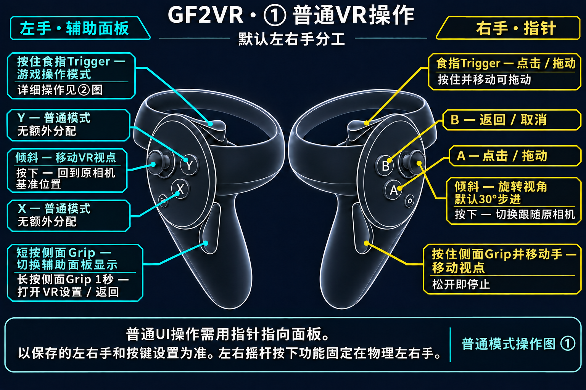
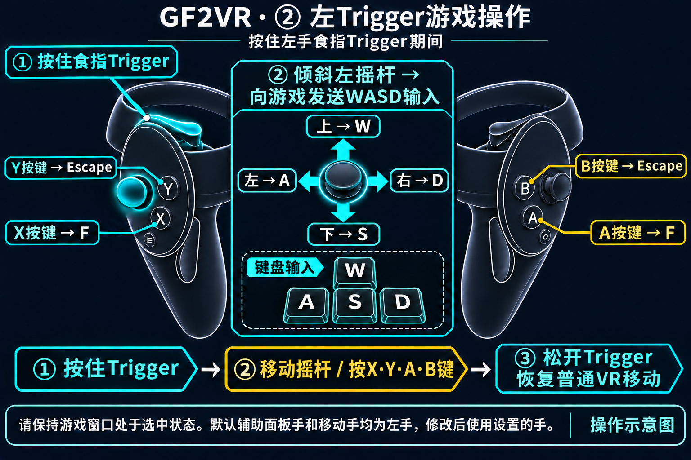

# GF2VR 1.3.10

[한국어](1.3.10.ko.md) | [English](1.3.10.en.md) | [日本語](1.3.10.ja.md) | [简体中文](1.3.10.zh-CN.md)

## 变更内容

- 改进角色接触判定，使其反映身体与服装表面。
- 修复手向内部按压时接触判定中断的问题。
- 新增接触判定显示。青色表示未接触，橙色表示接触中。可在PC或VR设置中实时切换，默认关闭。
- 将世界拖动默认值改为开启，同时保留已保存的设置。
- 新增四种语言的VR整体操作示意图。

## VR操作指南

### ① 普通VR操作

### ② 左Trigger游戏操作

按住左手食指Trigger时，默认移动摇杆向游戏发送WASD输入。上W、下S、左A、右D，X/A发送F，Y/B发送Escape。松开Trigger后恢复普通VR移动。

基于默认左右手分工的操作示意图。请区分食指Trigger与侧面Grip。按下摇杆是向下按压操作，左右摇杆按下功能固定在物理左右手。

**按住右手侧面Grip并移动手，可抓住世界并移动视点。松开Grip即停止。**

### X、Y、A、B按键

以上为默认左右手分工和按键设置。**按住左手食指Trigger**时进入游戏操作模式。如果更换辅助面板手，请使用该手的Trigger。

| 按键 | 普通UI操作 | 游戏操作模式 |
|---|---|---|
| X | 无额外分配 | F键 |
| Y | 无额外分配 | Escape键 |
| A | 点击 / 拖动 | F键 |
| B | 返回 / 取消 | Escape键 |

交换辅助面板手与指针手后，普通UI操作由X负责点击、Y负责返回。点击与返回的交换设置适用于普通UI。游戏操作模式固定使用物理按键X/A → F、Y/B → Escape。

左摇杆移动，右摇杆旋转。右Trigger或A用于点击和拖动，B用于返回。短按左Grip切换辅助面板，长按1秒打开VR设置。按住左Trigger时，移动摇杆发送WASD，X/A发送F，Y/B发送Escape。按住右Grip并移动手可拖动世界视点。

世界拖动在新建设置和恢复默认值时默认为开启。更新后保留已保存的ON/OFF。修改左右手分工或按键后，以保存的设置为准。

接触改进与显示适用于Dirty版。角色或服装的网格结构和激活的形变可能限制表面校正。用户已确认指定的接触开始、向内按压保持、离开及再次接触流程。这不代表全部角色、场景或两个平台均已分别实机验证。世界拖动默认值变更已通过自动检查，未另行进行HMD实机测试。
