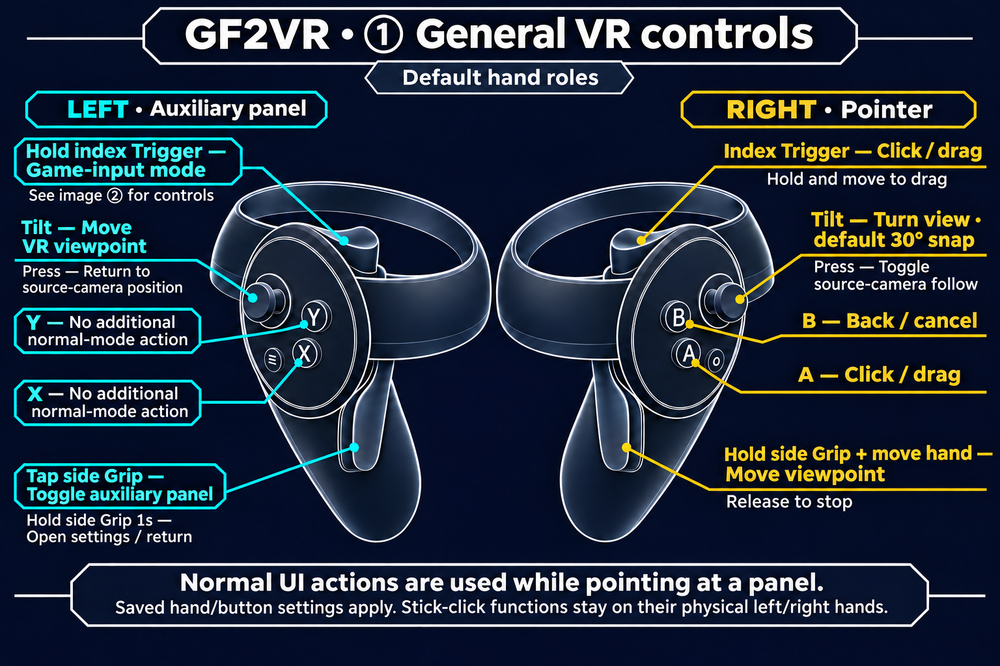
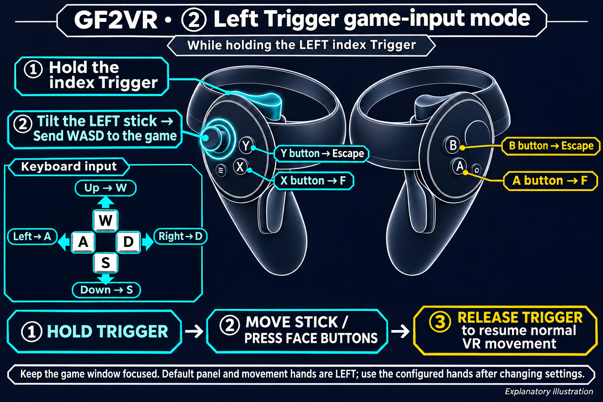

# GF2VR 1.3.11 — Face and thigh contact and pressing

- Added face and both thighs to the default Dirty contact regions.
- Face and thigh surfaces indent near the touching hand and return to their original shape after release. Default maximum depths are 8 mm for the face and 6 mm for thighs.
- Fixed butt contact remaining inside the body by including surface geometry with small but genuine skinning influence.
- Preserved contact markers, active color changes, and PC/VR live settings. Contact visualization defaults to OFF; existing saved values are retained.

Support depends on each character and outfit mesh. Indentation is skipped for meshes that cannot be handled safely. The user visually confirmed face/thigh pressing and restoration and butt exterior contact in a recent Haoplay run. Separate Steam HMD validation of these additions and coverage of every character and outfit remain pending.

After changing rendering scale, VR stereo restoration may take about 5–10 seconds. Wait for VR to return and the apply result to appear.

## VR controls

[Usage](../en/USAGE.md)
