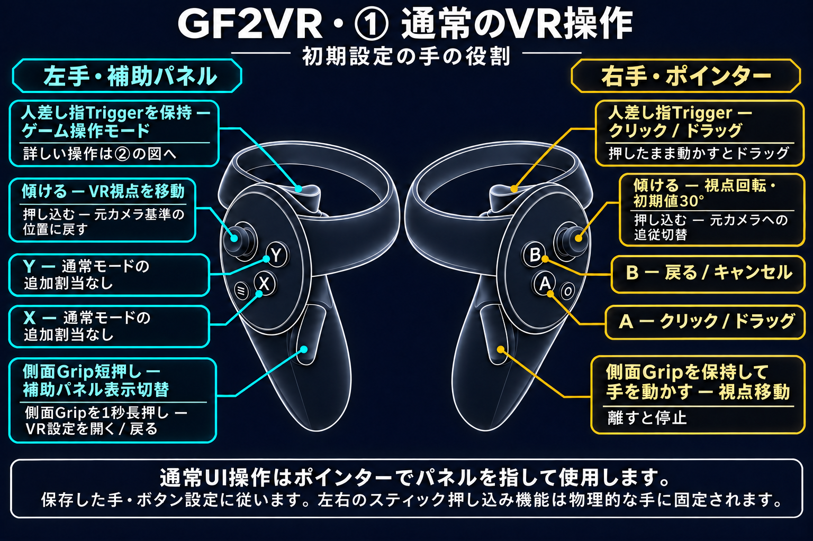
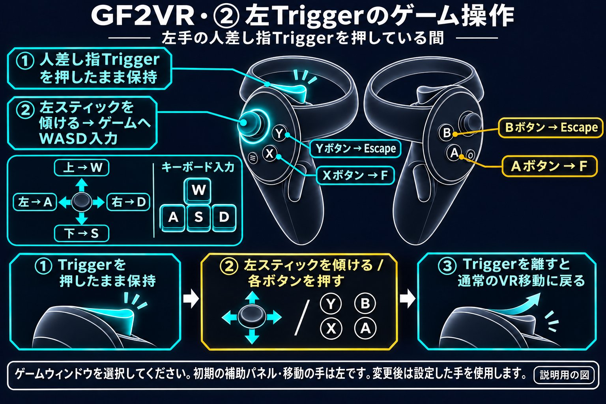

# GF2VR 1.3.11 — 顔・太ももの接触と押し込み

- Dirty版の標準接触部位に顔と左右の太ももを追加しました。
- 顔と太ももは手が触れた周囲がへこみ、手を離すと元の形に戻ります。標準の最大押し込み量は顔8mm、太もも6mmです。
- 実際のスキニング影響が小さい表面も取り込み、お尻の接触位置が体内に残る問題を修正しました。
- 接触位置表示、接触中の色変更、PC/VRのリアルタイム設定を維持します。表示の初期値はOFFで、保存済みの値は保持されます。

対応範囲はキャラクターや衣装のメッシュ構成によって異なります。安全に処理できないメッシュには押し込みを適用しません。最近のHaoplay実機で顔・太ももの押し込みと復元、お尻の外側接触が正常であることをユーザーが確認しました。追加機能のSteam HMD検証と全キャラクター・衣装の検証は未完了です。

レンダリング倍率を変更した後、VRステレオの復元に約5～10秒かかる場合があります。VRへの復帰と適用結果が表示されるまでお待ちください。

## VR操作方法

[Usage](../ja/USAGE.md)
