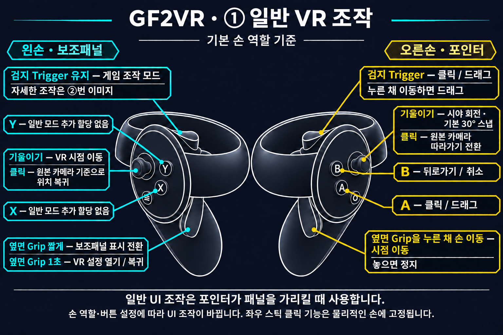
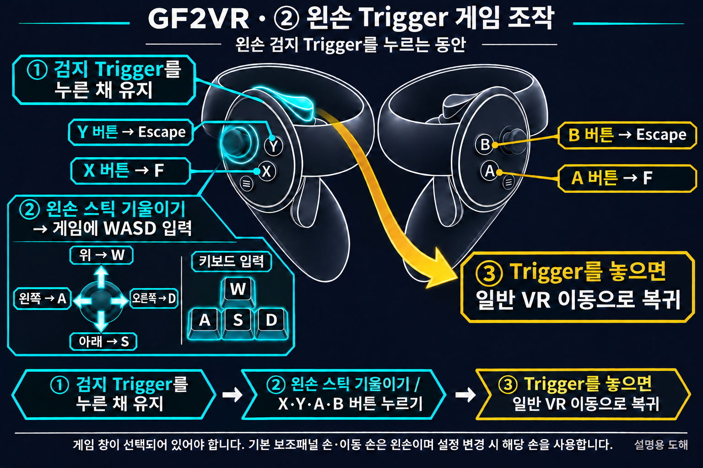

# GF2VR 1.3.11 — 얼굴·허벅지 접촉과 눌림

- Dirty 버전의 기본 접촉 부위에 얼굴과 양쪽 허벅지를 추가했습니다.
- 얼굴과 허벅지는 손이 닿은 주변이 눌리고, 손을 떼면 원래 모양으로 복원됩니다. 기본 최대 눌림 깊이는 얼굴 8mm, 허벅지 6mm입니다.
- 엉덩이 판정에 실제 스킨 가중치가 작은 표면도 반영하여 몸 안쪽에서만 잡히던 문제를 수정했습니다.
- 기존 접촉 표시·색상 전환과 PC/VR 실시간 설정을 유지합니다. 접촉 위치 표시 기본값은 OFF이며 기존 저장값은 보존합니다.

캐릭터·의상의 메시 구성에 따라 지원 범위가 달라집니다. 안전하게 처리할 수 없는 메시에는 눌림을 적용하지 않습니다. 사용자는 최근 Haoplay 실행에서 얼굴·허벅지 눌림과 복원, 엉덩이 외곽 판정을 정상 확인했습니다. Steam의 새 기능에 대한 별도 HMD 검증 및 모든 캐릭터·의상 검증은 아직 완료되지 않았습니다.

렌더링 배율 변경 후 VR 스테레오 복원에는 약 5~10초가 걸릴 수 있습니다. 복귀와 적용 결과가 표시될 때까지 기다려 주세요.

## VR 조작법

[Usage](../ko/USAGE.md)
