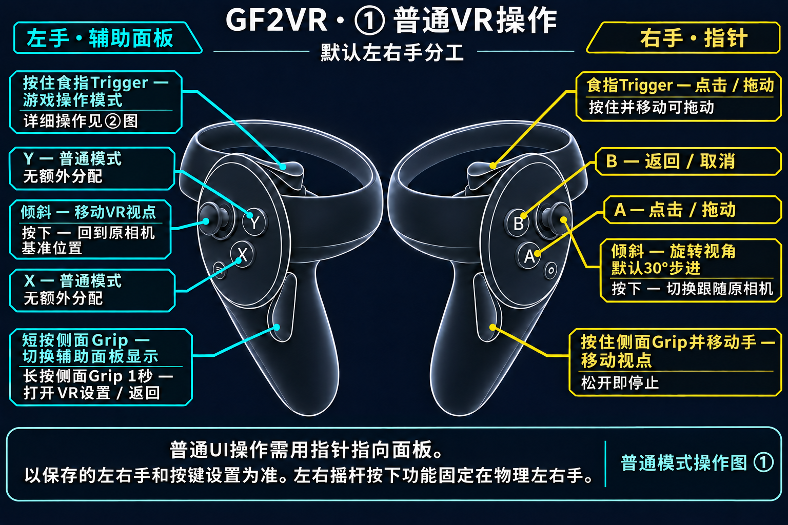
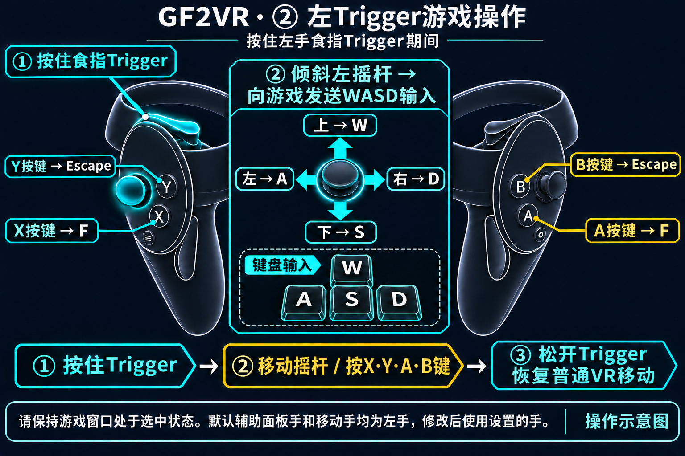

# GF2VR 1.3.11 — 面部和大腿接触及按压

- 将面部和左右大腿加入Dirty版的默认接触部位。
- 手部接触面部或大腿时，接触周围会局部凹陷，松手后恢复原状。默认最大按压深度为面部8毫米、大腿6毫米。
- 将具有较小但实际存在的蒙皮权重的表面纳入判定，修复臀部接触位置仍在体内的问题。
- 保留接触位置显示、接触颜色变化和PC/VR实时设置。显示默认关闭，已有保存值会保留。

支持范围取决于角色和服装的网格结构。无法安全处理的网格不会应用按压。用户已在最近的Haoplay实机运行中确认面部和大腿按压及恢复、臀部外表面接触均正常。新增功能的Steam HMD独立验证及全部角色、服装覆盖验证尚未完成。

更改渲染倍率后，VR立体画面恢复可能需要约5～10秒。请等待VR返回并显示应用结果。

## VR操作说明

[Usage](../zh-CN/USAGE.md)
