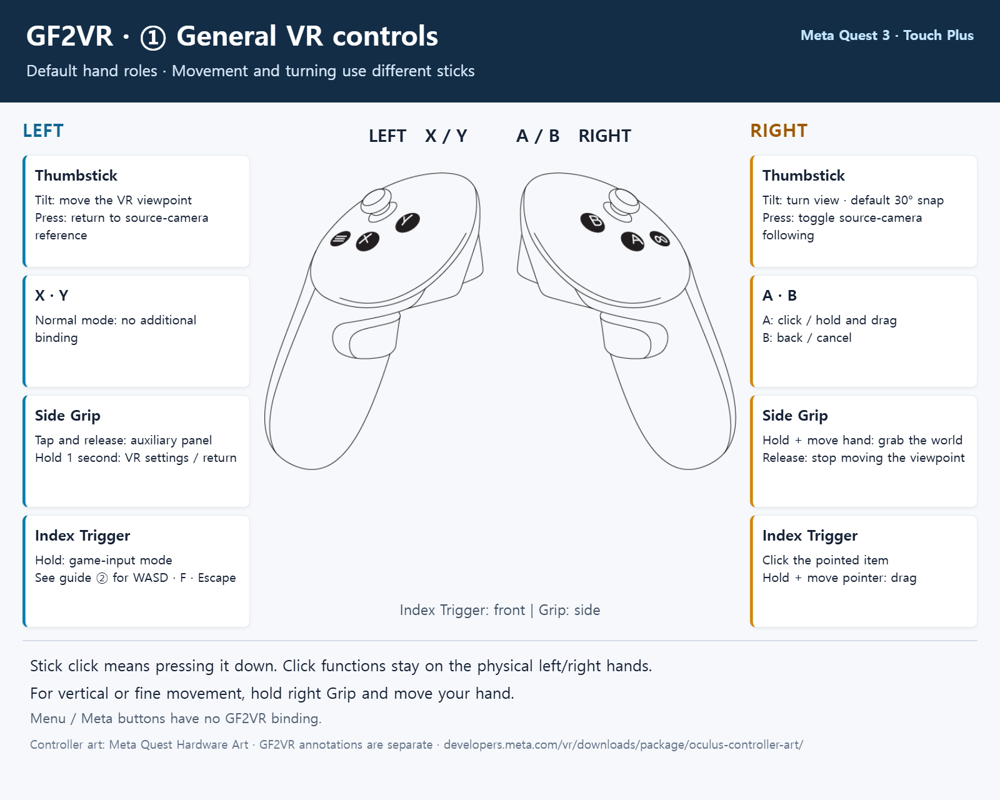
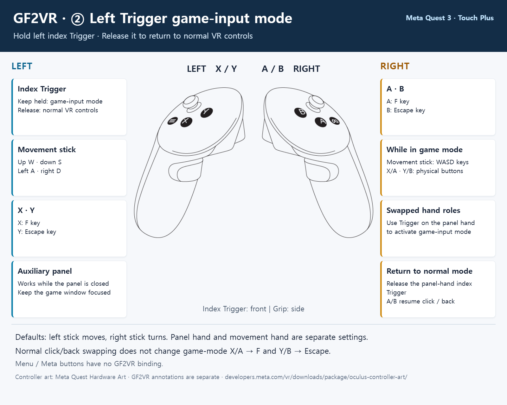

# 1.3.13 — Meta Quest 3 Touch Plus

[한국어](1.3.13.ko.md) | [English](1.3.13.en.md) | [日本語](1.3.13.ja.md) | [简体中文](1.3.13.zh-CN.md)

- Replaced general VR and game-input illustrations with official Meta Quest 3 Touch Plus artwork.
- Clarified buttons, sticks, Trigger/Grip and normal/game-input modes in Korean, English, Japanese and Simplified Chinese.
- Updated related controls documentation and artwork source/rights notices.
- Adjusted wrapping and spacing so control labels and instructions fit inside their cards.

Only images and documentation changed. VR DLLs, Configurator and Installer executables are identical to 1.3.12; existing settings and controls are unchanged.

[Controller art and rights](../en/CONTROLLER_ART.md)

