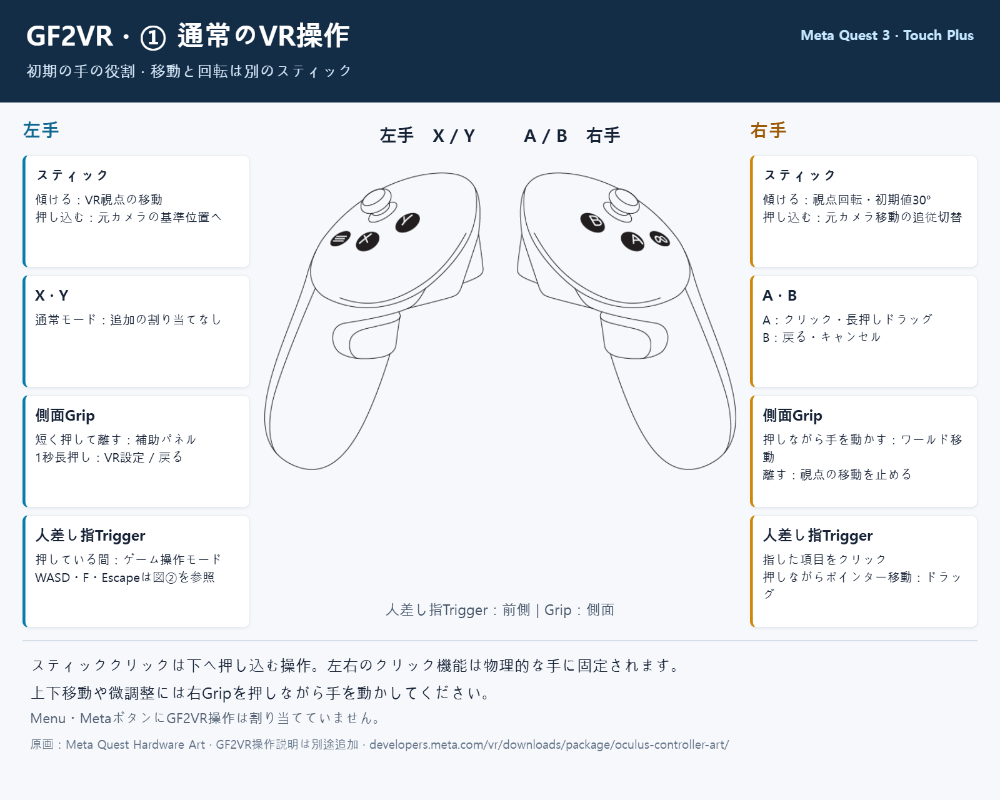
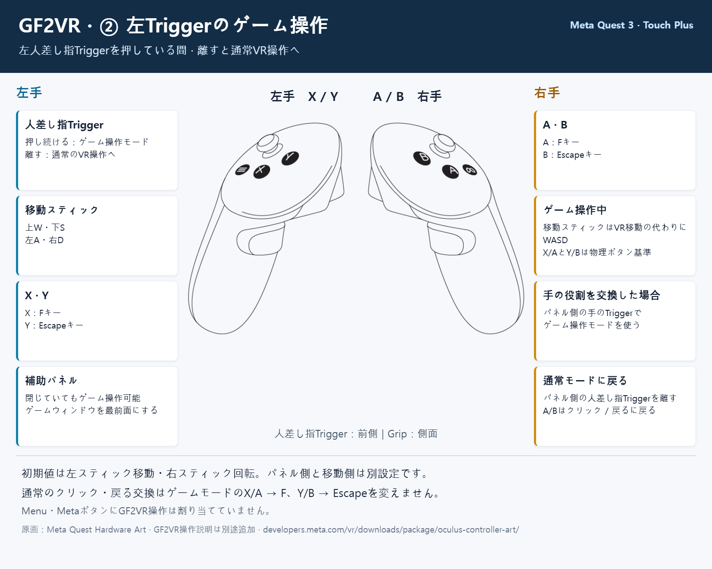

# 1.3.13 — Meta Quest 3 Touch Plus

[한국어](1.3.13.ko.md) | [English](1.3.13.en.md) | [日本語](1.3.13.ja.md) | [简体中文](1.3.13.zh-CN.md)

- 通常VR・ゲーム操作の図をMeta Quest 3 Touch Plus公式原画へ変更しました。
- 韓国語・英語・日本語・簡体字中国語でボタン・スティック・Trigger/Gripと通常/ゲームモードを明確にしました。
- 関連操作ガイドと画像の出典・権利案内を整理しました。
- 操作図の改行と余白を調整し、説明が枠内に収まるようにしました。

画像と文書のみの変更です。VR DLL・設定GUI・インストーラーの実行ファイルは1.3.12と同一で、既存設定と操作は変わりません。

[Controller art and rights](../ja/CONTROLLER_ART.md)

