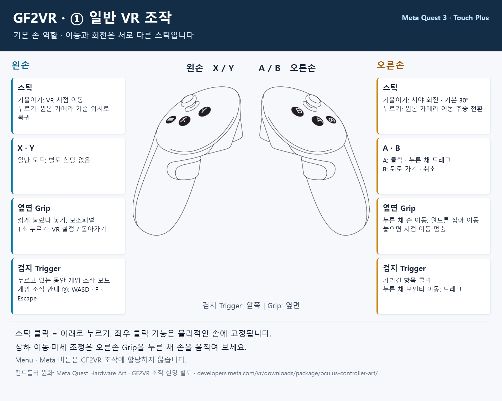
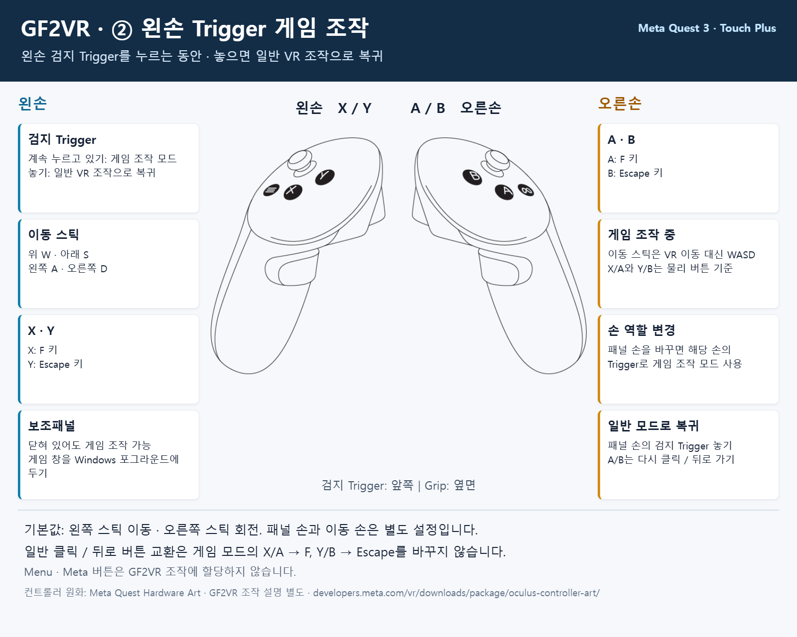

# 1.3.13 — Meta Quest 3 Touch Plus

[한국어](1.3.13.ko.md) | [English](1.3.13.en.md) | [日本語](1.3.13.ja.md) | [简体中文](1.3.13.zh-CN.md)

- 일반 VR·게임 조작 이미지를 Meta Quest 3 Touch Plus 공식 원화로 교체했습니다.
- 한국어·영어·일본어·중국어에서 버튼·스틱·Trigger·Grip과 일반/게임 조작 모드를 명확히 구분했습니다.
- 관련 조작 문서와 이미지 출처·권리 안내를 정리했습니다.
- 조작 이미지의 줄바꿈과 여백을 조정해 설명이 칸 안에 들어가도록 했습니다.

이미지와 문서만 변경했습니다. VR DLL·설정 GUI·설치기 실행 파일은 1.3.12와 동일하며 기존 설정과 조작은 바뀌지 않습니다.

[Controller art and rights](../ko/CONTROLLER_ART.md)

