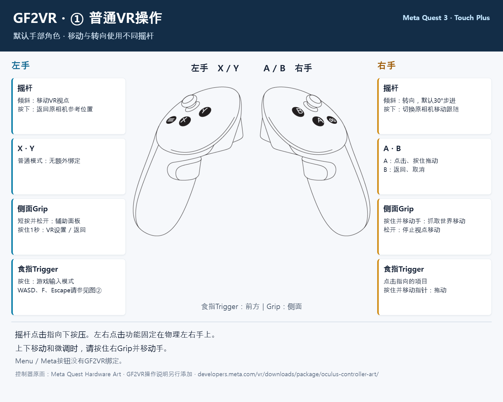
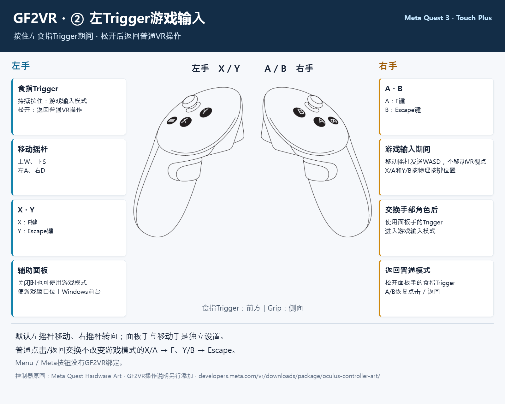

# 1.3.13 — Meta Quest 3 Touch Plus

[한국어](1.3.13.ko.md) | [English](1.3.13.en.md) | [日本語](1.3.13.ja.md) | [简体中文](1.3.13.zh-CN.md)

- 将普通VR和游戏输入图替换为Meta Quest 3 Touch Plus官方原画。
- 以韩语、英语、日语和简体中文区分按钮、摇杆、Trigger/Grip以及普通/游戏输入模式。
- 整理相关操作文档及图像来源、权利说明。
- 调整操作图的换行与留白，确保说明文字位于卡片框内。

仅更改图像和文档。VR DLL、设置GUI和安装器可执行文件与1.3.12相同，现有设置与操作不变。

[Controller art and rights](../zh-CN/CONTROLLER_ART.md)

