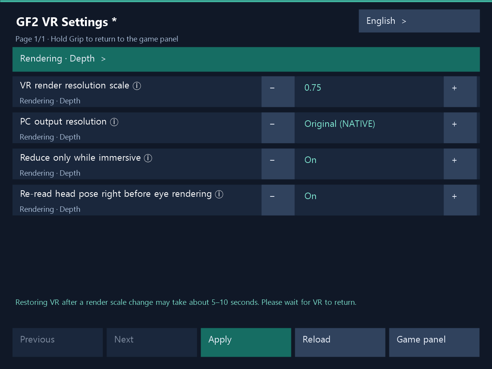

# 1.3.9 — In-game VR settings

Hold the auxiliary-panel hand’s side Grip for 1 second to open in-game VR settings and apply edits without restarting the game. The PC configurator also supports live application. Restoring VR stereo after a render-scale change may take about **5–10 seconds**. Please wait for recovery.

## In-game VR settings

1. Hold the auxiliary-panel hand’s side Grip for 1 second to open VR settings. The default hand is left. The gesture follows a hand-role swap. A short press and release hides or shows the current auxiliary panel.
2. Select items with the ray and edit values with the ± buttons or numeric keypad, then press **Apply**. Changes reach the running VR mode without restarting the game, with an actual application result. The PC configurator uses the same application path.
3. **After changing render scale, restoring VR stereo may take about 5–10 seconds.** A brief flat view may appear during application. Please wait for VR to return and for the application result. Recovery depends on GPU work finishing, render resources being rebuilt and a new stereo frame becoming ready.
4. Choose **Game panel** or hold Grip again to return to the original game auxiliary panel. Unsaved edits require discard confirmation. Release all buttons before resuming game controls.

While settings are visible, game clicks and keys, locomotion, artificial turning and world grab are blocked. Head and hand tracking remain available. In Dirty, character touch also remains available. If simultaneous PC and VR edits conflict, use **Reload** to read the latest settings before applying. Failed edits remain available for retry.

Korean, English, Japanese and Simplified Chinese are supported. The PC window and VR panel share the language preference in the same installation. The VR settings host reads it when the host starts.

Dirty runtime acceptance covers the requested VR settings controls, render-scale changes and stereo recovery flows on Steam and Haoplay. Clean was validated through the shared-code build and package checks.

UI example captured from the actual VR settings panel renderer while editing render scale 0.75. The footer asks the user to wait about 5–10 seconds for recovery.
