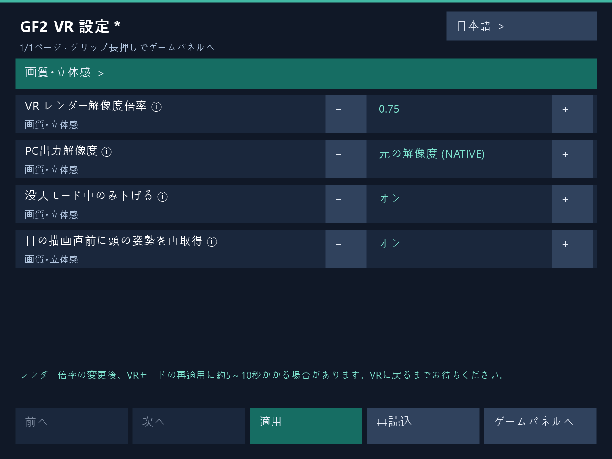

# 1.3.9 — ゲーム内VR設定

補助パネル側の手の側面Gripを1秒長押ししてゲーム内VR設定を開き、ゲームを再起動せず編集値を適用できます。PC設定画面も実行中の適用に対応します。レンダー倍率変更後のVRステレオ復元には約**5～10秒**かかる場合があります。復帰までお待ちください。

## ゲーム内VR設定

1. 補助パネル側の手の側面Gripを1秒長押しするとVR設定が開きます。既定は左手で、手の役割を交換すると操作側も移ります。短く押して離すと現在の補助パネルを表示または非表示にします。
2. レイで項目を選び、±ボタンや数値キーパッドで編集して**適用**を押します。ゲームを再起動せず実行中のVRに反映し、適用結果を表示します。PC設定画面も同じ適用経路を使います。
3. **レンダー倍率の変更後、VRステレオの復元に約5～10秒かかる場合があります。** 適用中は一時的にフラット表示になることがあります。VRの復帰と適用結果をお待ちください。復帰時間はGPU処理の終了、描画リソースの再構築、新しいステレオフレームの準備によって変わります。
4. **ゲームパネルへ**または再度のGrip長押しで元の補助パネルに戻ります。未適用の編集には破棄確認が表示されます。すべてのボタンを離してからゲーム操作を再開してください。

設定表示中はゲームのクリック・キー入力、移動・人工回転・ワールドグリップを停止します。頭と手の追跡を維持し、Dirtyではキャラクターへのタッチも維持します。PCとVRの同時編集が競合した場合は**再読込**で最新の設定を読み込んでください。失敗した編集値は再試行用に保持します。

韓国語・英語・日本語・簡体字中国語に対応します。同じインストール先のPC画面とVRパネルで言語設定を共有し、VR設定ホストの起動時に読み込みます。

DirtyのSteam・Haoplay実機確認範囲は、依頼したVR設定操作・レンダー倍率変更・ステレオ復帰です。Cleanは共通コードのビルドとパッケージ検査で検証しました。

実際のVR設定パネルレンダラーで生成したUI例です。レンダー倍率0.75を編集中で、下部に約5～10秒の復帰待ち案内が表示されています。
