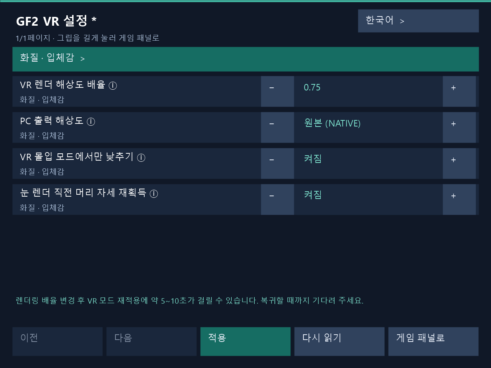

# 1.3.9 — 인게임 VR 설정

보조패널 손의 옆면 Grip을 1초 눌러 인게임 VR 설정을 열고, 게임 재실행 없이 편집한 값을 적용합니다. PC 설정창도 실행 중 적용을 지원합니다. 렌더링 배율 변경 후 VR 스테레오 복원에 약 **5~10초**가 걸릴 수 있으므로 기다려 주세요.

## 인게임 VR 설정

1. 보조패널 손의 옆면 Grip을 1초 누르면 VR 설정 화면이 열립니다. 기본은 왼손이며 손 역할을 교환하면 해당 손을 사용합니다. 짧게 눌렀다 놓으면 현재 보조패널을 숨기거나 표시합니다.
2. 레이로 항목을 선택하고 ± 버튼 또는 숫자 키패드로 값을 편집한 뒤 **적용**을 누릅니다. 게임을 재실행하지 않고 실행 중인 VR에 반영하며 실제 적용 결과를 표시합니다. PC 설정창도 같은 적용 경로를 사용합니다.
3. **렌더링 배율을 변경하면 VR 스테레오가 복원되기까지 약 5~10초가 걸릴 수 있습니다.** 적용 중 잠시 플랫 화면으로 바뀔 수 있습니다. VR이 복귀하고 적용 결과가 나올 때까지 기다려 주세요. 복귀 시간은 GPU 작업 정리와 렌더 자원 재구성, 새 스테레오 프레임 준비에 따라 달라집니다.
4. **게임 패널로** 또는 다시 긴 Grip으로 원래 게임 보조패널에 돌아갑니다. 미적용 변경이 있으면 폐기를 확인합니다. 버튼을 모두 놓은 뒤 게임 조작을 재개하세요.

설정 화면이 보이는 동안 게임 클릭·키 입력, 이동·인공 회전·월드 그립은 잠깁니다. 머리·손 추적을 유지하며 Dirty의 캐릭터 터치도 유지됩니다. PC와 VR에서 동시에 편집해 충돌하면 **다시 읽기**로 최신 설정을 불러온 뒤 적용하세요. 실패한 편집값은 재시도를 위해 유지됩니다.

한국어·영어·일본어·중국어 간체를 지원합니다. PC 설정창과 VR 패널은 같은 설치 폴더의 언어 설정을 사용하며 VR 설정 호스트가 시작될 때 저장된 언어를 읽습니다.

Dirty의 Steam·Haoplay 실기 수락 범위는 요청된 VR 설정 조작, 렌더링 배율 변경과 스테레오 복귀 흐름입니다. Clean은 공통 코드 빌드와 패키지 검사로 검증했습니다.

실제 VR 설정 패널 렌더러로 생성한 UI 예시입니다. 렌더링 배율 0.75를 편집 중이며 하단에 약 5~10초의 복원 대기 안내가 표시됩니다.
