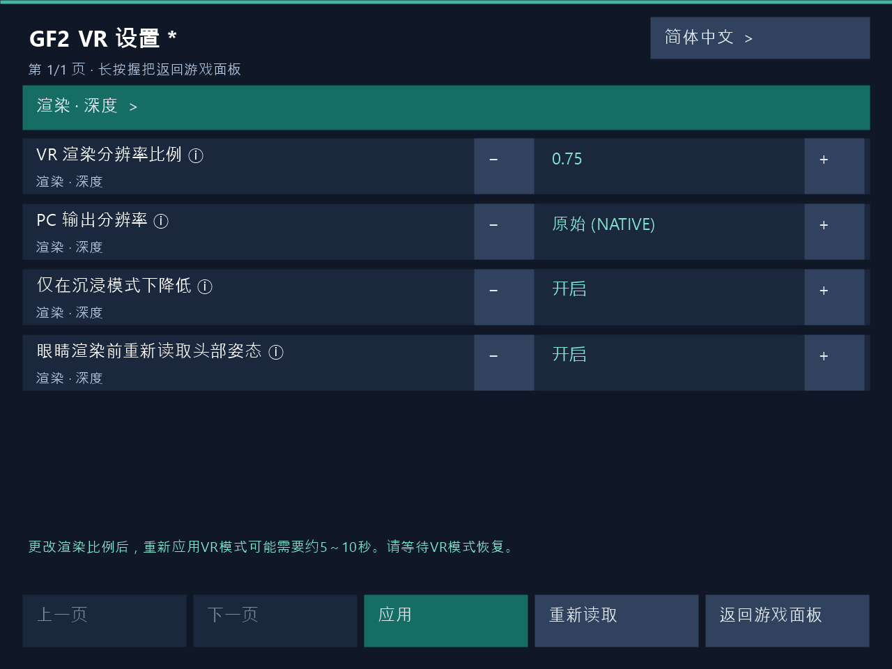

# 1.3.9 — 游戏内VR设置

长按辅助面板手的侧面Grip 1秒打开游戏内VR设置，无需重启游戏即可应用编辑值。PC设置窗口也支持运行中应用。更改渲染比例后，VR立体画面恢复可能需要约**5～10秒**，请等待恢复。

## 游戏内VR设置

1. 长按辅助面板手的侧面Grip 1秒即可打开VR设置。默认使用左手，交换手部角色后操作手也会随之更改。短按并松开可显示或隐藏当前辅助面板。
2. 使用射线选择项目，通过±按钮或数字键盘编辑，然后点击**应用**。无需重新启动游戏即可反映到运行中的VR，并显示实际应用结果。PC设置窗口使用相同的应用路径。
3. **更改渲染比例后，VR立体画面恢复可能需要约5～10秒。** 应用期间可能短暂切换为平面画面。请等待VR恢复和应用结果。恢复时间取决于GPU工作完成、渲染资源重建以及新立体帧准备。
4. 点击**返回游戏面板**或再次长按Grip返回原游戏辅助面板。未应用的编辑会要求确认放弃。请松开全部按钮后再继续游戏操作。

设置显示期间会暂停游戏点击、按键、移动、人工转向和世界抓取。头部与手部追踪保持可用，Dirty中的角色触摸也保持可用。如果PC与VR同时编辑发生冲突，请**重新读取**最新设置后再应用。应用失败时保留编辑值以便重试。

支持韩语、英语、日语与简体中文。同一安装目录中的PC窗口与VR面板共享语言偏好，VR设置宿主在启动时读取该偏好。

Dirty在Steam和Haoplay的实机确认范围为指定VR设置操作、渲染比例更改与立体画面恢复流程。Clean通过公共代码构建与打包检查进行验证。

由实际VR设置面板渲染器生成的UI示例，正在编辑渲染比例0.75，底部显示约5～10秒的恢复等待提示。
