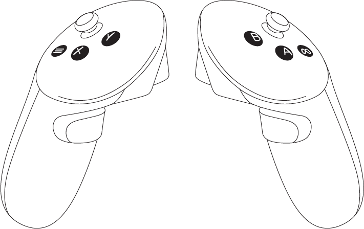

# Quest 3控制器图像与按钮名称

[한국어](../ko/CONTROLLER_ART.md) | [English](../en/CONTROLLER_ART.md) | [日本語](../ja/CONTROLLER_ART.md) | [简体中文](../zh-CN/CONTROLLER_ART.md)

用户指定的原图与官方**Meta Quest Hardware Art 1.8**中的`Meta Quest Touch Plus/Quest_03.png`像素一致。指南保留该原画，并在周围排版GF2VR操作说明。

| 位置 / 动作 | 按钮名称与区别 |
|---|---|
| 左手正面 | X、Y、摇杆、Menu |
| 右手正面 | A、B、摇杆、Meta |
| 食指Trigger | 控制器前方，与Grip为不同输入 |
| Grip | 侧面按钮，不指整个握柄 |
| 摇杆点击 | 向下按压摇杆，而非倾斜 |

控制器原画权利归Facebook Technologies, LLC及关联方所有，用于介绍对应产品的用户指南，不代表Meta合作、赞助或认可。GF2VR操作标签及排版由本项目添加，与Meta平台默认操作区分。

Copyright © Facebook Technologies, LLC and its affiliates. All rights reserved.

- [Meta Quest Hardware Art 1.8](https://developers.meta.com/vr/downloads/package/oculus-controller-art/)
- [Art Attribution License 1.0](https://developers.meta.com/vr/licenses/art-1.0/) · [License notice](../images/META-CONTROLLER-ART-LICENSE.txt)
- [General VR controls](../images/vr-controls-zh-CN.png) · [Game-input mode](../images/vr-game-input-zh-CN.png) · [GF2VR controls](USAGE.md)
