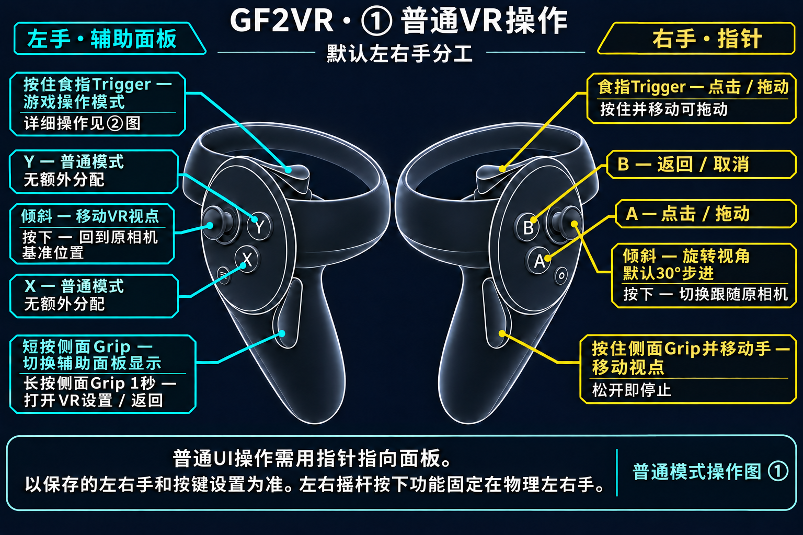
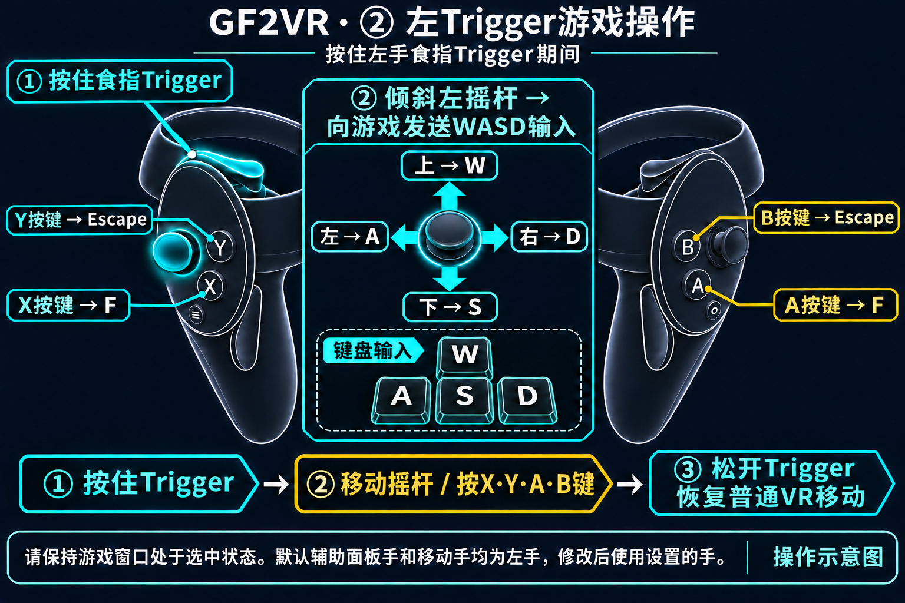
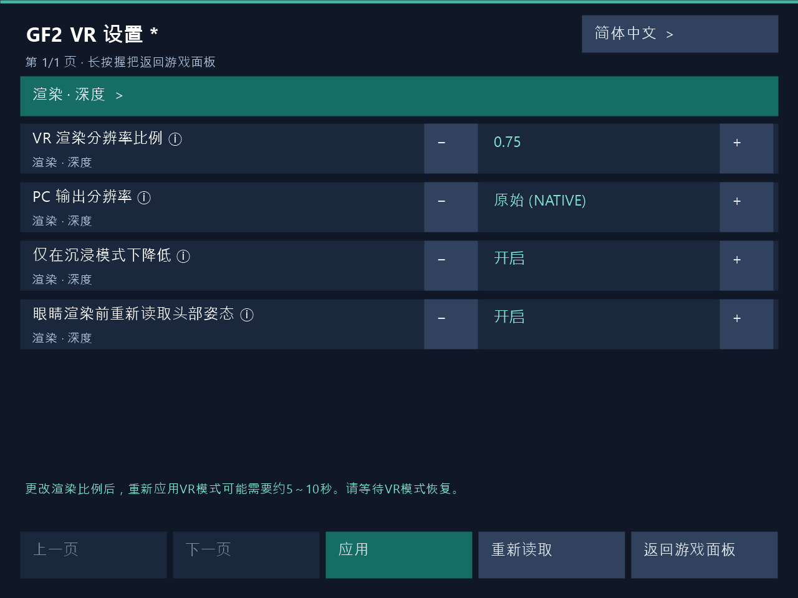

# 更新内容

[한국어](../ko/RELEASE_NOTES.md) | [English](../en/RELEASE_NOTES.md) | [日本語](../ja/RELEASE_NOTES.md) | [简体中文](../zh-CN/RELEASE_NOTES.md)

## 1.3.10

- 改进角色接触判定，使其反映身体与服装表面。
- 修复手向内部按压时接触判定中断的问题。
- 新增接触判定显示。青色表示未接触，橙色表示接触中。可在PC或VR设置中实时切换，默认关闭。
- 将世界拖动默认值改为开启，同时保留已保存的设置。
- 新增四种语言的VR整体操作示意图。

### ① 普通VR操作

### ② 左Trigger游戏操作

按住左手食指Trigger时，默认移动摇杆向游戏发送WASD输入。上W、下S、左A、右D，X/A发送F，Y/B发送Escape。松开Trigger后恢复普通VR移动。

基于默认左右手分工的操作示意图。请区分食指Trigger与侧面Grip。按下摇杆是向下按压操作，左右摇杆按下功能固定在物理左右手。

**按住右手侧面Grip并移动手，可抓住世界并移动视点。松开Grip即停止。**

### X、Y、A、B按键

以上为默认左右手分工和按键设置。**按住左手食指Trigger**时进入游戏操作模式。如果更换辅助面板手，请使用该手的Trigger。

| 按键 | 普通UI操作 | 游戏操作模式 |
|---|---|---|
| X | 无额外分配 | F键 |
| Y | 无额外分配 | Escape键 |
| A | 点击 / 拖动 | F键 |
| B | 返回 / 取消 | Escape键 |

交换辅助面板手与指针手后，普通UI操作由X负责点击、Y负责返回。点击与返回的交换设置适用于普通UI。游戏操作模式固定使用物理按键X/A → F、Y/B → Escape。

[1.3.10](../release-notes/1.3.10.zh-CN.md)

## 1.3.9 — 游戏内VR设置

长按辅助面板手的侧面Grip 1秒打开游戏内VR设置，无需重启游戏即可应用编辑值。PC设置窗口也支持运行中应用。更改渲染比例后，VR立体画面恢复可能需要约**5～10秒**，请等待恢复。

由实际VR设置面板渲染器生成的UI示例，正在编辑渲染比例0.75，底部显示约5～10秒的恢复等待提示。

Dirty在Steam和Haoplay的实机确认范围为指定VR设置操作、渲染比例更改与立体画面恢复流程。Clean通过公共代码构建与打包检查进行验证。

[1.3.9](../release-notes/1.3.9.zh-CN.md)

## 1.3.8 — 提升游戏更新适应能力

减少主页场景与摄像机绑定对混淆类名、字段名的依赖。验证唯一的元数据结构、当前场景与注册表的对象一致性，以及场景所属摄像机关系。结构不明确或发生变化时不会猜测选择。

发布的Dirty DLL与用户在Steam、Haoplay上实机验证的文件完全一致。主页VR及指定的角色背景切换均正常。Clean使用相同核心代码并通过构建及安装包检查，尚未单独验证HMD。已确认基本摄像机的所属关系解析，但未单独验证回退摄像机的实际VR画面输出。不能保证所有未来游戏更新的兼容性。

[1.3.8](../release-notes/1.3.8.zh-CN.md)

## 1.3.7 — 主页视角及游戏更新兼容性修复

修复当前Steam和Haoplay版本的主页VR进入及角色背景预览视角。使用当前背景时间轴所属的活动摄像机，避免始终选取固定场景摄像机。移除Dirty触碰入口对旧游戏内部辅助类名称的依赖。

Dirty主页视角已通过Steam和Haoplay用户实机测试。Clean使用相同核心代码并通过构建及安装包检查，尚未单独验证HMD。仅在已验证的引擎加载器结构不变时支持部分名称变更，不能保证所有未来更新的兼容性。没有新增Crewdeck或未连接HMD稳定性验证结论。

[1.3.7](../release-notes/1.3.7.zh-CN.md)

## 1.3.6 — 保护未连接HMD时的启动

在OpenXR确认HMD可用之前，推迟VR渲染Hook和专用桥接初始化。保留启动后连接HMD的等待能力；VR启用后的清理和恢复流程保持运行。包含1.3.5的Crewdeck清理修复。

针对Steam用户未连接HMD时启动失败或数分钟后崩溃的报告。未提供崩溃堆栈，尚未在受影响环境中确认解决。已通过21项初始化边界检查、现有恢复/时钟/Crewdeck测试及Clean/Dirty构建和安装包验证。

[1.3.6](../release-notes/1.3.6.zh-CN.md)

## 1.3.5 — 修复Crewdeck场景切换清理问题

修复场景卸载后已销毁的VR UI相机清理阻塞、导致下一组VR相机无法启用的问题，对应Steam/Darkwinter Crewdeck失败日志。仅对确认销毁的对象允许清理继续；存活或状态未知的安全检查及用户设置保持不变。

尚未在实际游戏/HMD中确认Crewdeck问题已解决。已通过27项模拟回归检查及Clean/Dirty构建和安装包验证。

[1.3.5](../release-notes/1.3.5.zh-CN.md)

## 1.3.4 — 游戏更新兼容性修复

适配Haoplay 3.0.5388和Steam 3.0.5400更新后的内部API名称。游戏更新后，旧映射无法找到VR初始化所需的API，此版本修复了该映射问题。

尚未进行实际游戏或HMD运行验证。已通过静态分析核对两个版本的游戏DLL，并完成API查找、Hook安全性、构建和安装包自动检查。仍可能存在其他运行时兼容性问题。

[1.3.4](../release-notes/1.3.4.zh-CN.md)

## 1.2.0 — Steam支持与手部、接触兼容性修复

支持Steam可执行文件目录及现有Haoplay目录结构。修复游戏更新后白色手部标记和角色接触消失的兼容性问题。Dirty独立处理活动层中同时可见的受支持角色；Clean不包含接触变形。

实机验证范围为Dirty在Haoplay Main、Activity的手部显示/接触，以及Steam Main的启动和立体显示。尚未单独确认Steam全部场景及新Clean DLL的HMD表现。请关闭游戏内抗锯齿。

完整的受管理1.1.6安装可在设置GUI中批准更新通知，升级至1.2.0，无需GitHub CLI或登录，保留版本类型及用户设置。1.1.4及更早版本或无法检查更新的旧客户端，请将所需ZIP完整解压到新目录，运行附带的GF2VR.Installer.exe安装一次。请先关闭游戏。界面语言仍为韩语、英语和日语。

发行版本为1.2.0。内部native构建ID中的130用于标识此前未公开候选中经过验证的同一DLL。常规安装程序不会静默覆盖手动替换或不属于本产品的文件。

## 1.1.6 — 修复自动更新

设置GUI启动时检查公开GitHub发行版。批准通知中的 **更新** 后，将下载、校验并安装。从1.1.6开始，无需GitHub CLI或登录。

修复旧客户端使用固定白名单拒绝新构建的问题。客户端校验发行版与文件哈希、版本类型及当前文件归属，再由经过验证的新安装程序完成最终构建校验、备份和安装。保留Clean/Dirty类型与用户设置。

1.1.4及更早版本需要此次手动更新一次：将所选Clean/Dirty ZIP完整解压到新文件夹，并运行其中的新GF2VR.Installer.exe。更新检查正常的1.1.5环境可直接使用GUI更新。旧版所需GitHub CLI缺失的用户也需此次通过ZIP安装一次。安装1.1.6之后，GUI更新无需CLI或登录。

本版保留与1.1.5完全相同的VR DLL。保留日志默认关闭、明确开启设置及首次清理排除状态，以及面板和接触设置。安装前关闭游戏与设置窗口。界面语言仍为韩语、英语和日语。

## 1.1.5 — 日志记录设置

Clean和Dirty均在设置GUI中新增 **诊断 → 自动记录日志**。默认 **关闭**，旧设置中缺少此项时也保持关闭。保存后重启游戏生效。设置程序的界面语言仍为韩语、英语和日语。

首次更新安装时，仅为日志关闭的用户清理一次旧VR自动日志。**日志开启的用户保留已有日志，并排除在此次首次清理之外。** 之后改为关闭也不会延迟删除旧日志。保留设置、其他模组文件和手动收集的资料。

排查问题时再开启日志。开启后会继续追加到同一构建的日志文件，容量可能持续增加。

更新1.1.5时，请将所选Clean或Dirty ZIP完整解压到新文件夹，并使用随附的新GF2VR.Installer.exe安装。旧设置程序可能拒绝新的native配置。保留已有设置。

## 1.1.4

**通用更新**

- 新增辅助面板手动设置

**Dirty版本**

- 新增角色接触时的振动反馈
- 新增角色接触晃动及相关设置

## 1.1.3

更新至 1.1.3：将完整的 Clean 或 Dirty ZIP 解压到新文件夹，使用其中的 GF2VR.Installer.exe 选择现有游戏位置安装。旧 1.1.2 设置程序无法验证新的 native 配置，因此会拒绝自动暂存并保留当前安装。请勿只复制 DLL 或混用包文件。

1.1.3 将 PR #1 的 3DMigoto 默认 wrapper 模式兼容性修改同时提供给 Clean 和 Dirty。保留游戏 wrapper，VR 复制与 OpenXR 使用实际 D3D11 设备/context。DLL 随附匹配的设置程序与安装程序元数据。

请使用默认 wrapper 模式，即省略或注释 [System] 中的 `hook`。`hook=recommended` 和 `hook=all` 不在支持范围内。`calls`、`crash` 用于日志/转储，并非此修复的必要选项。皮肤 INI 语法与重复规则警告属于其他问题。

> **使用 VR 前必须在游戏设置中关闭抗锯齿。**

PR 作者报告在 Dirty 开发构建中连续启动三次，确认 VR 与皮肤同时工作。这是贡献者的记录，不代表新 1.1.3 二进制已通过 HMD 验收。本次发布验证两种 native 构建、使用实际修改源码的 COM 同一性/失败路径、桌面构建及包完整性。没有重新运行游戏或 HMD。

贡献：[rgbtl1248](https://github.com/rgbtl1248)，[PR #1](https://github.com/deadpixel134/GF2Exilium-VR/pull/1)。

## 1.1.2

> **使用 VR 前必须在游戏设置中关闭抗锯齿。**

1.1.2 在安装程序初始界面和 README 中增加必须在游戏设置中关闭抗锯齿的说明。Clean 与 Dirty 显示相同提示，不自动修改游戏设置。VR DLL、设置程序及接触行为与 1.1.1 相同。

已确认 Quest 3 和 Galaxy XR 所报告的左右画面错位由抗锯齿导致。使用 VR 前，请在游戏设置中关闭抗锯齿。

## 1.1.1

1.1.1 分别提供 Clean 和 Dirty ZIP。白色手部球体为公共功能，接触变形仅属 Dirty。常规功能使用公共源码、版本及更新契约，支持同版本显式切换并保留设置。投影修正适用条件从仅水平轴扩展至具有充分垂直轴依据的情况。

新安装程序通过了 160 项版本切换与失败恢复、525 项所有权以及 175 项目录布局检查。公共投影修正通过 183,984 项离线断言及原有路径回归检查。由公开源码重新构建的两个原生 DLL 与发行文件逐字节一致。安装和设置程序包含所需 .NET 10.0.12 运行时。离线与安装检查不能替代真实游戏/HMD 验收。

已确认 Quest 3 和 Galaxy XR 所报告的左右画面错位由抗锯齿导致。使用 VR 前，请在游戏设置中关闭抗锯齿。

[1.0.2](https://github.com/deadpixel134/GF2Exilium-VR/releases/tag/v1.0.2) · [1.0.1](https://github.com/deadpixel134/GF2Exilium-VR/releases/tag/v1.0.1) · [1.0.0](https://github.com/deadpixel134/GF2Exilium-VR/releases/tag/v1.0.0)
