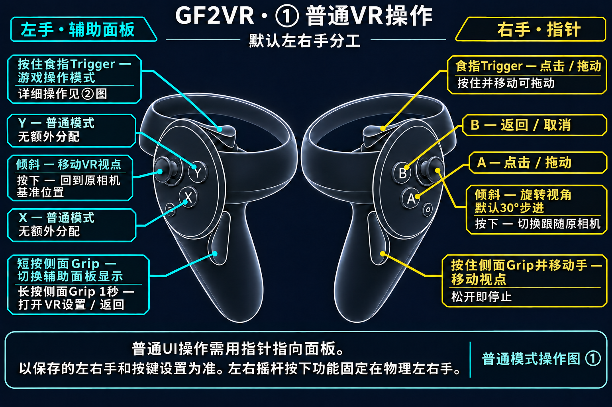
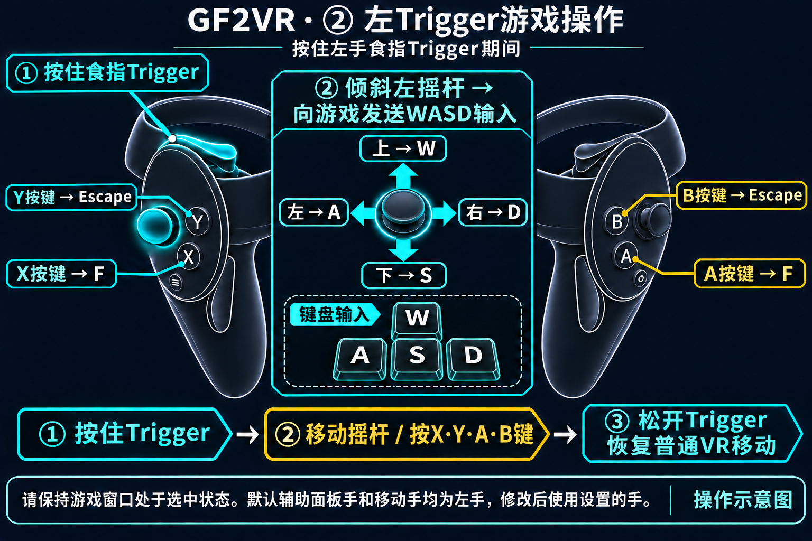
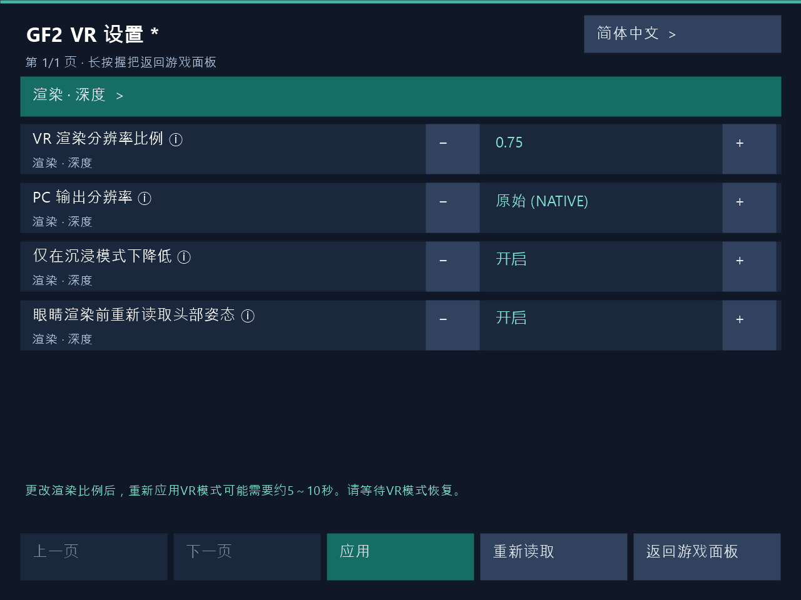

# 启动游戏与控制器操作

[한국어](../ko/USAGE.md) | [English](../en/USAGE.md) | [日本語](../ja/USAGE.md) | [简体中文](../zh-CN/USAGE.md)

[首页](../../README.zh-CN.md)

以下使用默认左右手分工。修改过角色或按钮时，请以保存的映射为准。使用 VR 前先关闭游戏内抗锯齿。

## VR操作指南

### ① 普通VR操作

### ② 左Trigger游戏操作

按住左手食指Trigger时，默认移动摇杆向游戏发送WASD输入。上W、下S、左A、右D，X/A发送F，Y/B发送Escape。松开Trigger后恢复普通VR移动。

基于默认左右手分工的操作示意图。请区分食指Trigger与侧面Grip。按下摇杆是向下按压操作，左右摇杆按下功能固定在物理左右手。

**按住右手侧面Grip并移动手，可抓住世界并移动视点。松开Grip即停止。**

### X、Y、A、B按键

以上为默认左右手分工和按键设置。**按住左手食指Trigger**时进入游戏操作模式。如果更换辅助面板手，请使用该手的Trigger。

| 按键 | 普通UI操作 | 游戏操作模式 |
|---|---|---|
| X | 无额外分配 | F键 |
| Y | 无额外分配 | Escape键 |
| A | 点击 / 拖动 | F键 |
| B | 返回 / 取消 | Escape键 |

交换辅助面板手与指针手后，普通UI操作由X负责点击、Y负责返回。点击与返回的交换设置适用于普通UI。游戏操作模式固定使用物理按键X/A → F、Y/B → Escape。

左摇杆移动，右摇杆旋转。右Trigger或A用于点击和拖动，B用于返回。短按左Grip切换辅助面板，长按1秒打开VR设置。按住左Trigger时，移动摇杆发送WASD，X/A发送F，Y/B发送Escape。按住右Grip并移动手可拖动世界视点。

**按住右手侧面Grip并移动手，可抓住世界并移动视点。松开Grip即停止。**

## 启动顺序

1. 确认头显和控制器已经连接，然后启动 SteamVR。
2. 如有需要，在PC设置窗口保存选项。游戏运行时也可通过PC窗口或VR面板应用。支持韩语、英语、日语和简体中文。
3. 按平常的方法启动游戏。安装程序不会代替你启动游戏。
4. 使用控制器操作游戏时，确认 PC 上当前选中的是游戏窗口。

编辑后点击保存或应用即可反映到运行中的游戏。如有问题请参阅[故障排查指南](TROUBLESHOOTING.md)。

## 正面面板与辅助面板

普通菜单或 2D 画面会显示在前方的正面面板上。在支持的 3D 场景中，立体画面成为主画面，需要时可以将原始游戏画面打开为辅助面板。

默认情况下，使用**左手 Grip**打开或关闭 3D 画面的辅助面板。此操作不会隐藏普通 2D 画面的正面面板。如果交换了左右手角色，请使用负责辅助面板的那只手的 Grip。

## 基本操作

以下说明以未更改左右手角色的默认设置为准。

| 操作 | 功能 |
|---|---|
| 左摇杆 | 移动 VR 视点 |
| 右摇杆 | 转动视角。默认采用每次 30° 的分段转向 |
| 右手指针 | 指向游戏画面中的项目。 |
| 右手 Trigger 或 A | 点击所指项目 |
| 右手 B | 返回、取消 |
| 左手 Grip | 短按切换辅助面板显示，长按1秒打开或退出VR设置 |

再次分段转向前，需要先让摇杆回中，再次推动。按住点击并移动指针即可拖动。

更改左右手角色或点击、返回按钮后，操作也会相应变化。移动、转向摇杆的左右手分配，与面板、指针的左右手分配分别设置。

## 游戏操作模式：WASD、F、Escape

**按住负责辅助面板的那只手的 Trigger 时**，会切换到游戏操作模式。默认是左手 Trigger。

- 移动摇杆改为输入游戏的 **WASD**，不再移动 VR 视点。
- **X 或 A** 输入 **F**，**Y 或 B** 输入 **Escape**。
- 松开 Trigger 后，恢复 VR 移动和普通 UI 操作。

即使没有打开辅助面板，也可以使用此模式。请与用于普通 UI 点击的指针手 Trigger 区分。没有输入反应时，先确认游戏窗口是否已被选中。

## 用世界抓取调整视点

世界抓取在新建设置和恢复默认值时默认为开启，更新后保留已保存的ON/OFF。

使用默认的右手 Grip 与右手追踪时，按住右手 Grip 并移动手部，即可像抓住世界并移动它一样调整视点。松开按钮后停止，再次按下可继续操作。

可以更改激活按钮或要追踪的手。不过，辅助面板 Grip、游戏操作模式 Trigger 和指针 UI 操作在某些情况下优先处理，请同时查看[设置指南](SETTINGS.md)。

## 按下摇杆调整视点与跟随

以下操作用于 3D VR 画面。这不是推动摇杆，而是**像按按钮一样向下按下摇杆**。

| 操作 | 功能 |
|---|---|
| 按下物理左摇杆 | 将通过世界抓取或摇杆移动改变的视点，恢复到当前原始相机的基准。 |
| 按下物理右摇杆 | 开启或关闭对原始相机运动的跟随。 |

即使更改了移动手设置，左右摇杆按下的功能也不会互换。相机跟随用于决定是否跟随原始相机的运动，与转头观察或手动移动分别独立。

恢复视点后，如需再次使用世界抓取，请先松开当前按住的 Grip，再重新按下。通过右摇杆按下更改的跟随状态只在本次游戏中有效。下一次启动时的初始状态，需要在设置程序中另行保存。

世界大小、立体感、移动速度联动，以及启动时的跟随设置，见[设置指南](SETTINGS.md)。

## 游戏内VR设置

由实际VR设置面板渲染器生成的UI示例，正在编辑渲染比例0.75，底部显示约5～10秒的恢复等待提示。

1. 长按辅助面板手的侧面Grip 1秒即可打开VR设置。默认使用左手，交换手部角色后操作手也会随之更改。短按并松开可显示或隐藏当前辅助面板。
2. 使用射线选择项目，通过±按钮或数字键盘编辑，然后点击**应用**。无需重新启动游戏即可反映到运行中的VR，并显示实际应用结果。PC设置窗口使用相同的应用路径。
3. **更改渲染比例后，VR立体画面恢复可能需要约5～10秒。** 应用期间可能短暂切换为平面画面。请等待VR恢复和应用结果。恢复时间取决于GPU工作完成、渲染资源重建以及新立体帧准备。
4. 点击**返回游戏面板**或再次长按Grip返回原游戏辅助面板。未应用的编辑会要求确认放弃。请松开全部按钮后再继续游戏操作。

设置显示期间会暂停游戏点击、按键、移动、人工转向和世界抓取。头部与手部追踪保持可用，Dirty中的角色触摸也保持可用。如果PC与VR同时编辑发生冲突，请**重新读取**最新设置后再应用。应用失败时保留编辑值以便重试。

支持韩语、英语、日语与简体中文。同一安装目录中的PC窗口与VR面板共享语言偏好，VR设置宿主在启动时读取该偏好。
